[toc]


发布于: 广东
创建时间: 2023-8-29 17:13:28
点赞总数: 840
评论总数: 247
收藏总数: 1546
喜欢总数: 176

> 之前我在文章 [橙子：给大家看看手机上0.5ms的全动态实时GI](https://zhuanlan.zhihu.com/p/569620109) 里提了一下这个全实时GI。当时因为考虑到项目要上GDC去说，所以没有给大家公开具体的算法思路。可能让有的人觉得有些不快吧。乘着我现在有了点时间，终于可以给大家详细说说这个高性能GI是怎么实现的啦。  
> 这个0.5ms是高通835的数据。

就是之前这个文章

[https://zhuanlan.zhihu.com/p/569620109](https://zhuanlan.zhihu.com/p/569620109)

## 内容超长谨慎阅读

## 1. 写在前面

我会告诉大家它的算法指导思想是什么。它的演化过程又是什么，还有还有它是按着怎样的一个思路来做，从而能得到这样快的一个性能。最后还有关于我个人的一些对于图形算法，或者说自然界的物理规律。这些对于开发一些具有创新性的东西。窝觉得还是比较有意义的。

 **最后最后，我会从零开始，刨析，罗列出我的一些公式的推导。以及怎么从一个形而上学的方式来理解它！！从而，希望每个人都可以很容易的实现这样一个算法！要是社区里有大佬可以在项目里落地它，或者能帮助我进一步完善它，我会万分荣幸的！** 

 **放点对比美图:** 

 **（等我补充）** 

##  **2. 移动平台的缺陷** 

当我们考虑一个算法跑的快不快时，我们最直接考虑到的一件事情是这个算法的时间复杂度！对于任何一个计算机科班出身的大家来说都是很浅显的。换句话说，我们无非是在考察这个算法指令数有多少，要跑多少Cycle这件事。但是事实上是，当今的移动SOC它的算力都是非常强悍的。我就单纯说算力这件事：


其中，其实高通845 和 A12都是比较老的移动端芯片了，但是他们的算力都在Switch之上。但是实际的结果却是，Switch现在移植了大量的主机游戏，比如Crysis2, Crysis3, Dying Light 等等。都是跑的延迟管线的游戏，它们的画面表现远远秒杀了一众手游。目前手游除了几个特别头部的，大部分都是页游画面。更不用说现在最新的移动端SOC，比如高通的8Gen2苹果的A16，这样的性能怪兽了。性能已经远远超越了PS4这些上一代主机。但是为什么移动平台没有出现各类3A这些高品质的游戏。

 **带宽** 

就是，其实抛开算力，如果我们看带宽会发现。移动平台的芯片带宽依然很憋屈。比如移动平台为啥做TBDR，不就是为了省电，但是省电就牺牲了性能。这也就是为什么大家做移动端开发很怕纹理采样，觉得这玩意开销特别高。因为大部分时间，我们都卡在带宽上面。而高的带宽，就会带来严重的发热，所以移动平台上，我们往往跑不到特别高的频率，实际上性能就没法全部发挥出来。

 **特别杂乱的访存的算法，对移动端一定是不友好的！！！！** 

 **(划重点，非常重要)** 

___

## 3. 当今GI算法的三大流派

其实不管是现在火的Lumen，BiPT，或者是SDFGI还是Surfel GI，还是前几年的SVOGI，VXGI，还是LPV。又或者是更古典的PRT。其实都可以分为三大流派

### 3.1 预计算类

预计算类大家做手游开发用的比较多。比如各个工作室现在爱搞的各种PRT以及它的变种，全境封锁的那个GI以及它的各个变种。或者是更古老的光图，还有前两年的Local Radiance Probe，都是属于预计算类的。这类算法的特点就是 **开销低，部分动态，或者完全静态。** 

 **对于实际项目开发来说，这类需要烘焙的算法，需要大量占用美术的开发时间，往往烘焙一下就是半天，而且预计算数据是很占包体的！！！！** 

 **还有它不能动，一般是场景不能动。更古老的是光源不能动** 

### 3.2 追踪类

追踪这类这几年特别火爆，特别是主机平台，都是大力跟上。这里的追踪我指的不只是硬件的光线追踪。但凡是任何包括Trace这种操作的算法，都应该归类到追踪类上，比如Lumen，Surfel GI，SDFDDGI，VXGI，SVOGI，这些。我都认为是基于追踪的。因为 **它们的访存是随机的。** 随机的访存这件事，意味着它对移动平台是极度不友好的。

### 3.3 传输类

这类算法，其实已经被遗忘在历史的角落里了。比较著名的有LPV，再后来，好像没有什么算法了吧。LPV最大的问题在于它的RSM，导致它只能计算单次反弹而且无非处理遮蔽。在UE4里，默认的GI算法就是LPV。之前传说是因为SVOGI开销太大了，所以最后只剩了LPV，其次它的画面表现太寡淡了。不是很值得。

## 4. GI算法对画面的贡献

其实大家都很喜欢讨论算法本身，讨论算法的数学原理，但是我其实更想从美术想要什么的这个视角出发来解构一下，GI对画面的贡献到底是什么。从这个角度出发，在实际游戏工业中，我们可以忽略一些数学上的正确性和精度，去往所谓的视觉友好的角度去凑。我们可以知道什么才是GI对画面真正有贡献的地方，我们就需要把更多的精力画在这上面。总结起来其实就两个点： **把画面压实，让画面柔和。** 

这其实对应于GI计算我们解构出的两个成分：

 **各类的遮蔽，尤其是天光遮蔽** 

 **反弹的Color Bleeding** 

我们看到很多移动端的GI算法都把精力放在了反弹上而忽略了遮蔽。这样的GI其实是没啥用的。我给大家看几个对比图：

 **GI全关** 

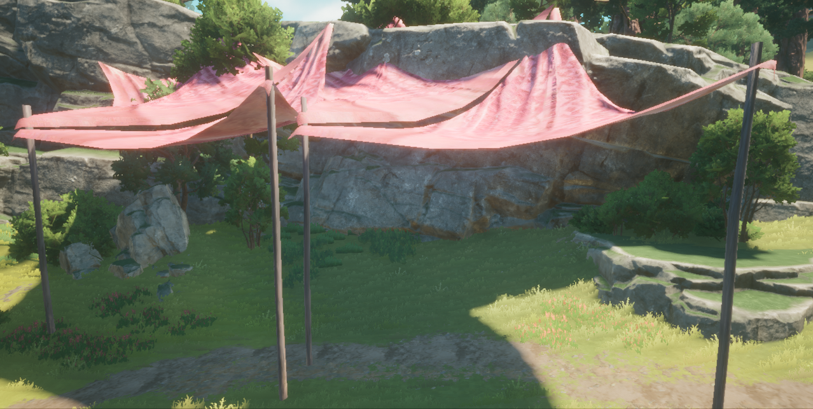

 **GI只有反弹** 

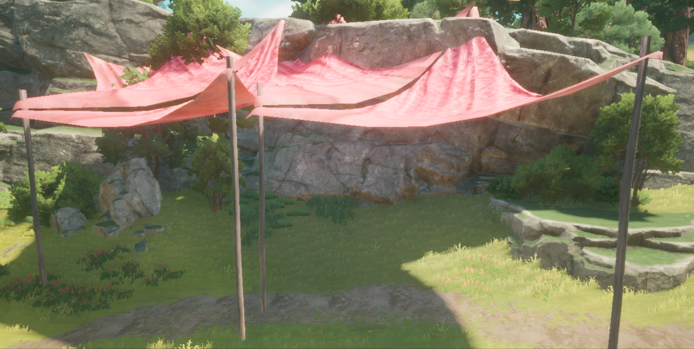

GI只有遮蔽

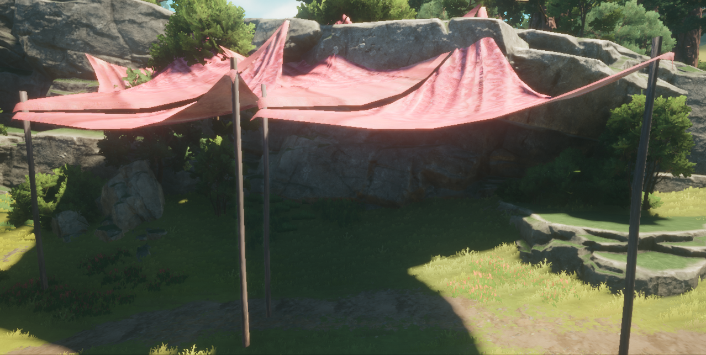

GI On

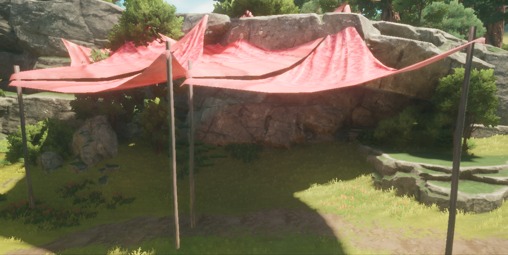

可以看到，单用LPV或者各类VPL算法我们可以得到只有反弹的GI效果。但是画面显得很平。同样的，某些算法在移动平台上做阉割，往往算不起遮蔽，也很容易得到只有反弹的GI效果， **这样的手游容易变成页游画面** 

如果手机硬件支持光追我们可以得到一个简单的天光遮蔽得到近似的只有遮蔽的画面效果。但是会显得很阴沉。有点近似于早些年的主机游戏的画面观感。

 **只有GI成分完整的GI才是真正对画面的贡献大。** 

___

##  **5. GI from Local Radiance Transfer （进入正题）** 

那么怎么样做一个高性能的实时GI，同时又拥有完整的GI成分呢。

### 5.1 算法的思路脉络

首先，基于追踪的这类算法是肯定不可行了 **（这句话仅有效到2025年，再过几年，硬件跟上后，基于追踪的算法可以很容易移植上手机）。** 其次，我们不要各类预烘算法，什么PRT，光图这类，我们统统不考虑，因为这类算法要么光动不了，要么场景动不了，而且需要大量烘焙时间。我不是反对烘焙，我反对大量的巨量的烘焙。那么其实只剩一类算法可以考虑，就是基于传输的GI算法。所以这里我给它起名叫 **Local Radiance Transfer。局部辐射传输。** 为啥不传输辐照度呢，因为那个太糊了，移动平台本身各种东西就吃紧，没必要传输一个更低精度的数据。

### 5.2 LPV和光能传递的局限

那么，我们最先考虑的就是LPV这类，但是很不幸，它的表现非常差。随便看几个LPV的例子：

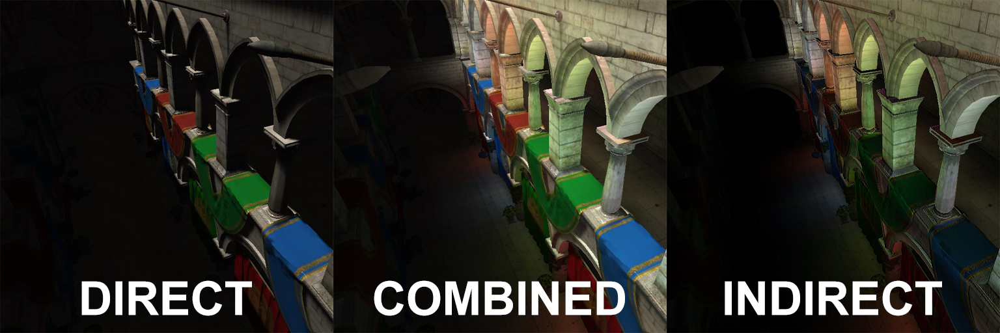

 **就是它只做了简单的一次反弹，而且没有考虑到遮蔽，导致画面异常诡异。** 

然后我们再说一类很容易被大家无视的算法，叫光能传递。可能很多人甚至都没有听说过。但是我敢赌大家应该都玩过，Minecraft。嗯嗯。就是minecraft！！！！

不知道大家有没有注意过，MC里这些黑漆漆的AO是怎么计算出来的。而且MC是有手机版的，它在非常垃圾的手机上都能运行这种算法计算出大片的天光遮蔽！！！这就是光能传递。

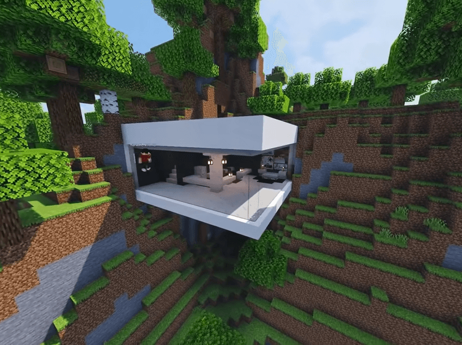

它虽然物理不正确但是它很快

在MC的官网上有详细介绍MC的光能传递算法，本质上就是格子按能量去衰减，这个算法可以用一个嵌套的卷积操作来表示。[https://bugs.mojang.com/browse/MC-138211](https://bugs.mojang.com/browse/MC-138211)

### 5.2 元胞自动机

我太喜欢元胞自动机了，所以我一定要在这里给大家安利一下。它就是一个kernel一直卷啊卷。但是真的可以做很多有意思的事情。

大家来看我的这个ShaderToy，展示了一个元胞自动机  

[https://www.shadertoy.com/view/XdVBWG](https://www.shadertoy.com/view/XdVBWG)

 **元胞自动机还可以用来做流体模拟！！** 在《A New Kind Of Science》 这本书里，提到了用元胞自动机做流体模拟的方法，我给大家翻一下：

首先就是定义一些领域内的算子：

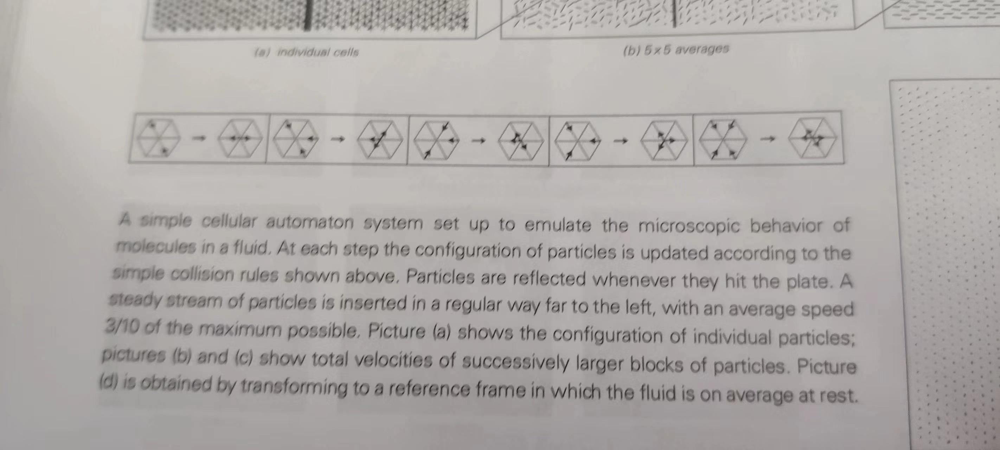

有了这个我们就可以把它卷积起来：

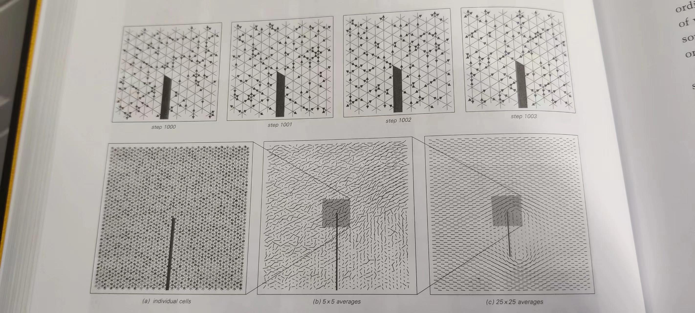

在更大尺度上的结果，可以看到已经有流体的样子了

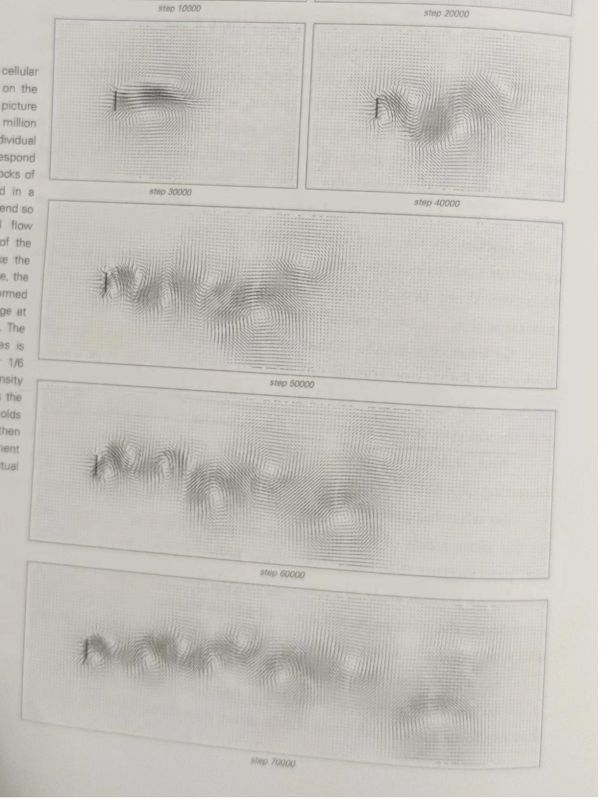

 **有没有发现，其实可以转化为位运算(#\`O′)！！！** 

为啥要说胞胞机呢，因为我这个算法就是从胞胞机出发的。它包含了胞胞机所具有的一切性质，也可以叫它胞胞机GI，甚至因为这种性质。 **我们可以看到这个GI带有的光的波动性！！，比如干涉条纹，和光波。给大家看两个早期视频，啾！！** 

%[](https://www.zhihu.com/video/1679893996720189440)%[](https://www.zhihu.com/video/1679894234277314560)

（那个你们不要吐槽我民科，虽然我真的有点民科的气质，但是我后面会给出好看的数学推导的，搓手手）

 **这里，如果有对胞胞机感兴趣的，我成立了一个胞胞机教，以及胞胞机教的进阶版，永恒回归教。它们都是从胞胞机出发来探索和理解世界的本源的！！我是大教主（尖叫）！可以加入我教！！** 

### 5.3 LPV+光能传递

这里讨论的不是简单的加法，是从这个路子出发，我们去设计一套物理正确（这个正确是指在算力无穷的情况下，随着算力的衰减这个准确度会下降）的新的GI算法。

先考虑LPV的缺陷：

1.   **需要RSM** 
2.   **只能计算单次反弹** 
3.   **没有遮蔽** 

再考虑光能传递的缺陷：

1.   **物理不正确** 
2.   **没有反弹** 

接下来我要开始介绍我的GI算法惹，首先我会先引入一系列新的概念。算法的大致流程如下：

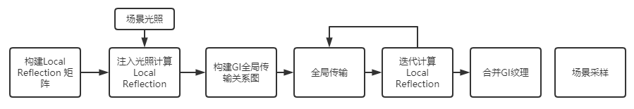

 **5.4 局部空间和局部传输算子** 

咳咳这两个是我自己起的名词，它的定义是这样的：


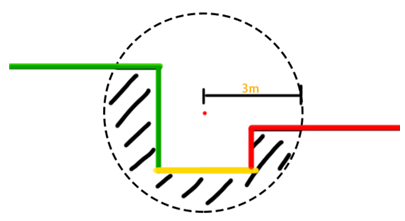

即在某一个小空间内，如上图1米半径的空间内。我们去考察它的GI性质。更进一步的，我们可以把这个复杂的空间内的反弹操作近似成对一个这样的球空间的操作：

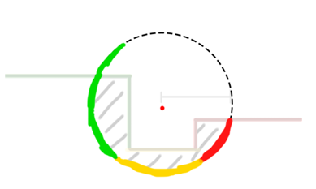

那么在这个空间下，计算GI是不是方便多了！我把这个空间里计算的GI称作Local GI。进一步的，我们可以把这个球用几个SH表示（SH不熟悉的自己去学嗷，接下来全是SH），它们分别是SH\_BaseColor，SH\_localVisibility。考虑一个GI的迭代函数：

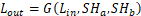

其中L\_in 为进入到Local GI的光照，不管它是啥， L\_in 和 L\_env 等L项全部是SH，这里的全部是SH。如果SH\_a为该小区域的basecolor（划掉，其实是DiffuseColor，抠字眼好累，大概就是那个意思）。SHb为该小区域的可见性，那么会有式1:

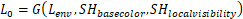

L\_0 为该Local GI的第0次反弹光，L\_env为照入这块Local区域的直接光。同时还会存在一个迭代球的Local的第i次反弹：

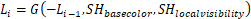

那么对于L\_localGI 有：

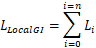

对于GI迭代函数。

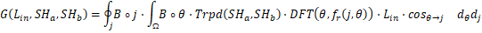

其中B为对方向j的SHBasis算子，Trpd(SH\_a, SH\_b)为对SH\_a和SH\_b的Triple Product， DFT(theta) 为求解SH在方向theta上的Diffuse传输系数，f\_r(j, theta)为brdf函数，由于Trpd(SH\_a, SH\_b)对于固定的Probe始终唯一，所以可以预计算。

我们可以看看这样一个简单的Probe，啾！！按照上面的思路做一个简单的小球，随手做一个，它对光照有怎样的相应：

%[](https://www.zhihu.com/video/1679900680213753856)

为什么放不了GIF。好讨厌啊！

可以看到，即使没有全局GI，单是局部的GI已经能够较好地反应墙角这种区域的反弹光效果。

  

 **我们上面这个过程，如果可以光追一个小空间内的小小PRT效果会更好！因为范围非常小，小于单个物件内，只需要针对逐个物件做预计算就可以了。如果是粗的实时计算也是跑的动的。** 

  

 **8.30更新** 

___

### 5.5 Local Transfer Matrix的全局视野

到了这里，大家可能会觉得这玩意，不就是PRT吗？嗯嗯，它确实在某个角度上看是一个PRT但是加了两个约束，一个约束是小范围，第二个约束是小范围内的简化。这样有怎样的好处呢？

这里有一个红色的Cube和一个白色的Cube。它们的所有布满空间中的Local Transfer Matrix如下：

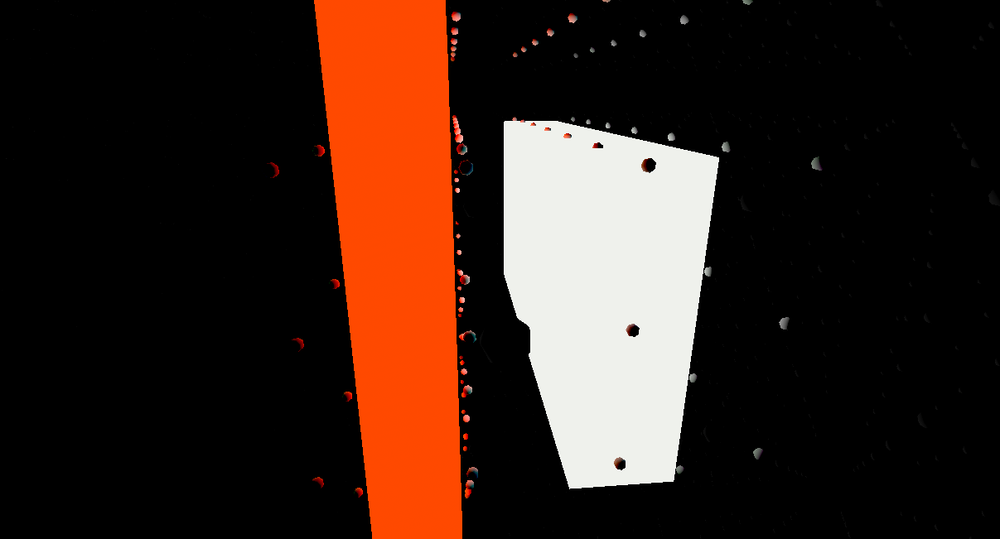

 **可以看到，Local Transfer Matrix只有在物件附近才是有值的，其余部分为全0！！！！** 

这里展示的不是反弹，只是单纯的Local Transfer Matrix。同时由于这种Local Transfer Matrix是只和领域相关的，它完美的规避了PRT计算量巨大的问题。求解一个Local Transfer Matrix只需要考察它周围的领域，甚至是一个体素化场景的周围26 个点的直接访存。 **这样的访存是极度Cache友好的** 

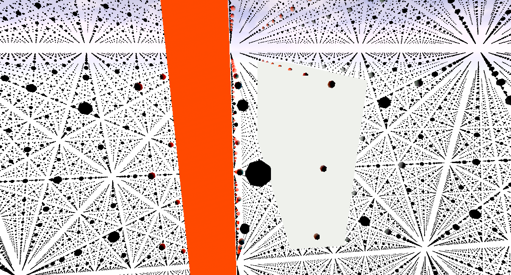

 **所以这些小球球都是在CPU上实时构造的！！！** 

 **我们再来看看局部遮蔽的情况：** 

同样的，局部遮蔽只有在物件附近有值，远处为全1

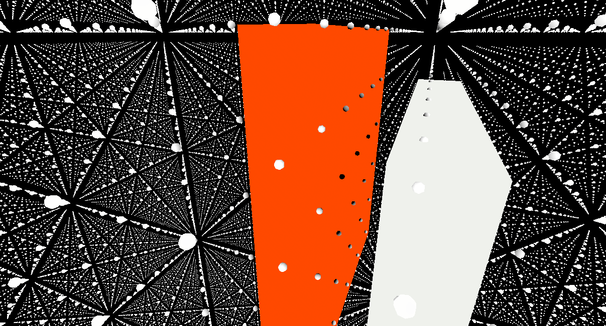

 **PRT的问题就在于预计算的Probe是全局相关的，导致了两个缺陷，一个是Probe的烘焙极慢。第二个是场景不可变，因为Probe是全局性的。这里考察的全部都是局部的信息，信息密度足够低所以全部的数据都能够被实时计算，而且场景随意变化。而且由于这种局部性，内存上可以做巨量的压缩。** 

 **其他的如SDF，它的Global SDF构建非常缓慢（在移动端上），也是由于它的全局性。但是Local SDF的使用依赖于Trace访存不友好。当然SDF的使用本身也需要Trace，所以访存也不友好。** 

目前，我们只靠这些廉价的局部信息只能得到一个类似VPL效果的LocalGI，并不能得到一个漂亮的全局GI。接下来我讲怎么把这个局部GI变成一个物理正确的全局GI。

### 5.6 全局可见性传输

在做GI的时候，我们有一个开销比较高的问题就是所谓的天光遮蔽。其实就是天光的阴影。这个东西会不太好算而且需要巨量的Trace，但是在现在的这个体系下，计算天光遮蔽就会变得异常简单。我们只需要把局部的可见性上传到GPU上，使用AB Buffer通过一个简单的卷积操作来迭代出来就可以了：

 **对于每个Probe，每帧只考虑它周围临界26个Probe的可见性，并统计它们的可见性保存为自身的可见性。可以理解为就是在算Bloom。。。** 

 **（可以无限分帧）** 

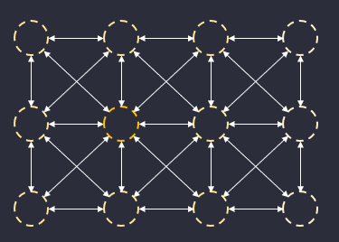

这样随着时间的迭代。我们的可见性就可以用特别远的地方传递到另一个特别远的地方，从而局部可见性变成了全局可见性。这个操作还有一个好处就是它的访存非常友好，不需要任何Trace只需要考虑它的领接关系，我们就可以进行可见性的传输，而且这个可见性是带方向的。

原谅我有点懒，做动图真的太麻烦了（等我录个视频放上来好了），我给大家看下传输完的全局可见性长什么样。

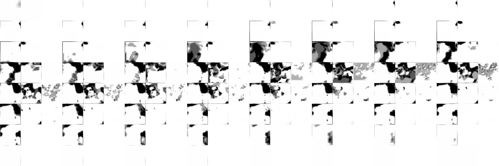

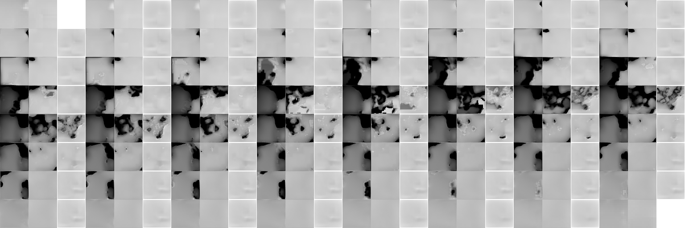

因为SH的第0阶系数和AO就是一个倍数关系，这里我只展示了SH的第0阶系数。这里的数据都是体纹理平铺来展示的，可以看到纯黑的地方就是物件内部，但是物件的遮蔽被传输了出去。而且是带着方向的。

### 5.7 全局光照传输

在上面，我们已经完成了全局可见性的传输，这份数据主要用于做天光遮蔽以及天光的反弹。其实天光可以更全局光照传输放在一起，这样可以进一步节省性能，但是实际的测试下来会发现，经过传输的天光，方向性会有比较大的削弱，毕竟为了性能，实际使用的是2阶的SH，它对方向性的表达能力和保持能力有限，经过较长距离的传输，天光的方向性基本丢失了，因此把天光遮蔽单独提了出来，只有天光的间接光照部分参与传输。

Radiance Transfer的过程其实和可见性的传输非常的像，主要就是做Bloom，但是其中会有一些trick来加速这个计算过程。它的计算就是每个Probe 去访问周围的26个probe获取它们的光照信息，并把它们拿过来作为自己Local 空间的入射光照：

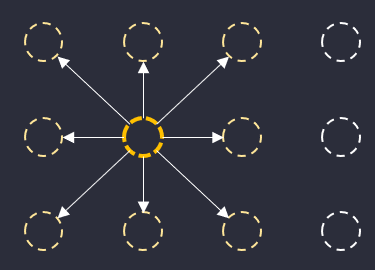

为了进一步减少实时运算的性能开销。我们可以对这个操作进行分帧，在二维空间中的Probe传输，我们可以分为两帧来做间隔传输：

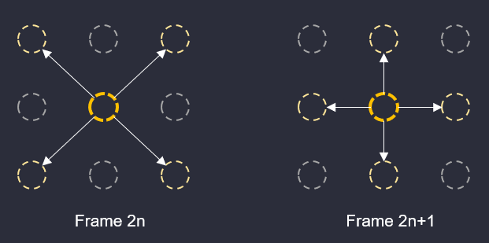

在三维空间中，传输的patten变得比较复杂，如下图所示：

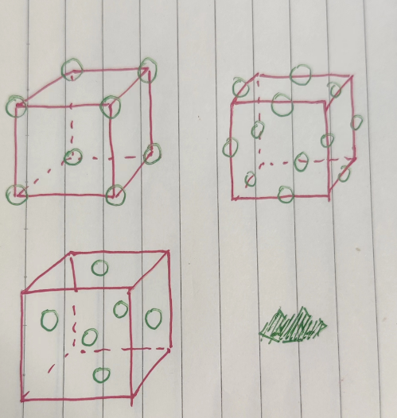

 **实际上跑这3组patten的实际开销还是太高了。在实际测试发现，只跑边上的这组产生的GI效果和全跑基本类似，同时加入dither可以完全类似跑3组的效果，因此实际上我只跑了边上的这组，并把它拆到3帧里，类似于3个四面体的顶点。所以我们只需要采样临接的4个probe。** 

接下来是光照注入。我们的光照分为面光源和解析光源两部分。解析光源我们又把方向光单独独立出来，因为它是没有具体范围的，而点光源以及Spot Light 以及面光源我们单独一类。整体的传输流程如下：

```cpp
// 这个流程可以被独立优化一下，我这里伪码只说大体的思路
// 比如 Mesh Light 和 Local Light的注入都可以优化一下。
foreach probe 
{
	SHVector InComingLight;
	if(probe not in Shadow)
	{
		InComingLight += DirectionalLightSH;
	}
	if(probe in MeshLight) 
	{
		InComingLight += MeshLightSH;
	}
	if(probe in LocalLight)
	{
		InComingLight += LocalLightSH;
	}

	// Gather 26 Direction SH Incoming Light
	for(otherProbe in Direction26)
	{
		InComingLight += Trpd(otherProbeSH, -otherProbeViSH);
	}

	// than apply local visibility
	InComingLight = Trpd(InComingLight, probeViSH);

	// than do local reflection
	probeSH = InComingLight * LocalTransferMatrix;
}
```

单看伪码，这个算法真的非常非常的简单。就这样我们就可以完成GI的光照传输流程，而且随着时间的推移它会变成Inf Bounds。其中的Trpd就是SH中的Triple Product，直观理解过去就是做mask。

经过上诉的传输过程，我们可以得到传输后的GI体纹理：

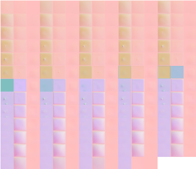

接下来我们讲怎么把这些效果合成我们最终Basepass用到的GI 数据。

### 5.8 Screen Space Gather

这个ScreenSpaceGather不同于Lumen的Screen Space Gather，只是用于减少Basepass对体纹理访存的开销。它就是一个低分辨率的屏幕空间pass，通常为渲染分辨率的25%。

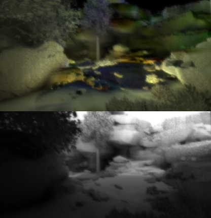

其中的RGB通道就放反弹，A通道放单独的天光遮蔽。最后我们只需要在Basepass里采样这张图就可以了！

### 5.9 CPU侧的场景管理

由于在GPU上做传输，因此CPU上就需要去管理整个GI Scene以及，Probe的构建。在上文中，我们说过Local Transfer Probe的构建是不需要Trace的，它的构建由周围的26个邻接体素构成。接下来我就来详细说说，这个GIScene是怎么管理的。

首先，我们需要维护一个最基本的场景管理解构。这个结构需要能快速的查询某一个空间内的GI Primitive。在具体的算法实现中，我使用了一个Grid的划分来存储这些GI Primitive的指针。每个Gird的格子我称作Trunk。那么每个Trunk包含如下信息：

-   Trunk覆盖范围内的 GI Primitive List
-   周围邻接Trunk的指针（用于临接快速寻址）
-   Cache

在场景管理中，我们添加和删除GI Primitive时，会先进行一个粗粒度的划分，这个粗粒度的划分会快速的把一个物件划分到它对应的Trunk里，并对Trunk置脏。脏的Trunk意味着它对应的Cache失效，需要重新更新。那么实际上一个GI Primitive可能会被多个Trunk包含，比如它可能有比较大的BBOX。具体的结构就如下图所示：

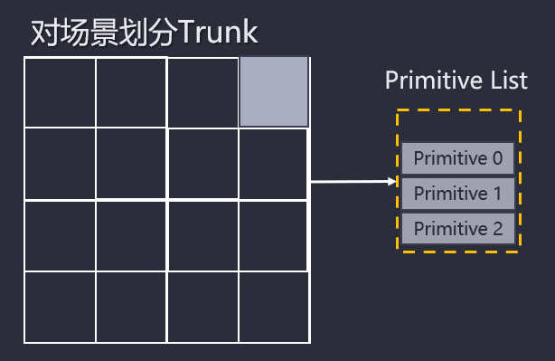

那么GI Primitive需要包含哪些数据呢？目前有3大类，它们分别是Color SDF，Height Field Data，Precomputed local transfer Matrix。对于一个GI Primitive 来说，它同时只需要其中一种数据，就可以进行GI计算了。未来其实可以考虑如Lumen这样的Mesh Card更高效的逐物件的GI数据表达。

 **Color SDF：** 

Color SDF是由两份数据构成，一份是一个逐物件的Local SDF数据。另外一个是物件的粗粒度体素化的Color 数据。Color SDF的存储开销一般控制在一个物件8KB左右。

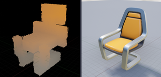

这种数据也通常会用在SDF DDGI这样的算法中。

 **Height Field Data：** 

这个用来处理地形，它包括地形的高度图数据，以及它的极低分辨率基色数据。

 **Precomputed Local Transfer Matrix：** 

这个是我们算法独有的逐物件GI数据。它的内容和前面提到的Local Transfer Matrix一摸一样。但是它的精度更高。这个更高精度不是指它的数据更多。而是因为它可以在离线构造获得更高的精度。更高的精度包括更细腻的局部遮蔽及反弹信息。它能够把物件表面的一些法线细节也考虑在内，以及物件空间内的更小范围内的更复制遮蔽和传输关系。在离线构造这个矩阵时。我们可以用Trace来构造。并且由于Local Transfer Matrix的线性性质。我们可以在运行时直接拼接成Global 空间的Local Transfer Matrix。

以上的3种数据结构都是为了构造出我们的Local Transfer Matrix。

### 5.10 CPU侧的Local Transfer Matrix构造

在上文中，我反复体积到所谓的Cache友好这件事。因为Cache友好我指的不只是更少的访存，它同时意味着更临近的访存。我希望的是整个GI算法中，从头到尾都没有Trace（Ray Cast）这个操作。那么怎么用一个Cache极度友好的方法来构建Local Transfer Matrix？

首先，我们已经拥有了一个Grid划分的GI Scene。在这个Scene里，在目前Mobile平台上，我假定一个Trunk内由8x8x8个Probe组成。那么每个Probe的位置都是完全已知的，以及它要查询的GI Primitive列表也是已知的。对于一个Probe来说，目前我需要它周围的26个临接信息来构造它的Local Transfer Matrix（实际可以更少）。那么这些临接信息就完整的布满了整个Trunk空间。那么比如Color SDF这种数据：我们只需要把对应左边，变换到GI Primitive的Local 空间，然后即可直接访存Color SDF来获取某个位置的信息。对于Height Field Data也一样。对于Precomputed Local Transfer Matrix也一样。它们的区别只在于合成Local Transfer Matrix的操作。

对于Color SDF和Height Field Data来说，相当于做了个快速的体素化，我们需要知道26个点的邻接体素信息，然后直接用我上面给的代码即可转为Local Transfer Matrix。

对于Precomputed Local Transfer Matrix而言，则不需要访存这么多的信息，它只需要得到当前位置的信息并把它当作当前位置的Local Transfer Matrix，如果有多个覆盖，相加即可。对于Local Visibility，做Triple Product即可。

至此，我们已经得到了每个Trunk内的Local Transfer Matrix。这些数据构造了我们整个的GI Scene。接下来只 **需要把有值的Trunk数据上传到GPU做传输即可** 。

### 5.11 Local Transfer Matrix的自发光

局部传输矩阵的特殊性，参考5.5，局部传输矩阵的构造，只需要给到Diffuse颜色。在局部传输矩阵的平坦数学空间下，它可以非常顺滑的实现从非自发光到自发光的变化。对于Diffuse反射率我们认为它小于1是吸收部分能量，等于1是完全反射能量，而大于1则表示它会发出能量，因此在构造局部传输矩阵时，我们能够非常精巧的实现GI的自发光效果，只需要把构造的Diffuse大于1即可，那么这个矩阵就是在发出能量的。我们可以看下发出能量的GI是什么表现

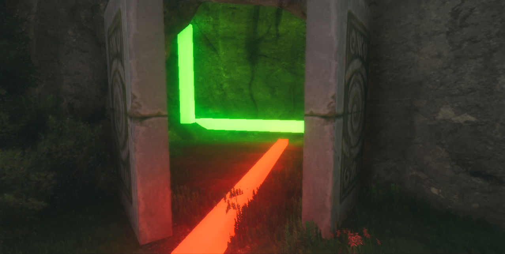

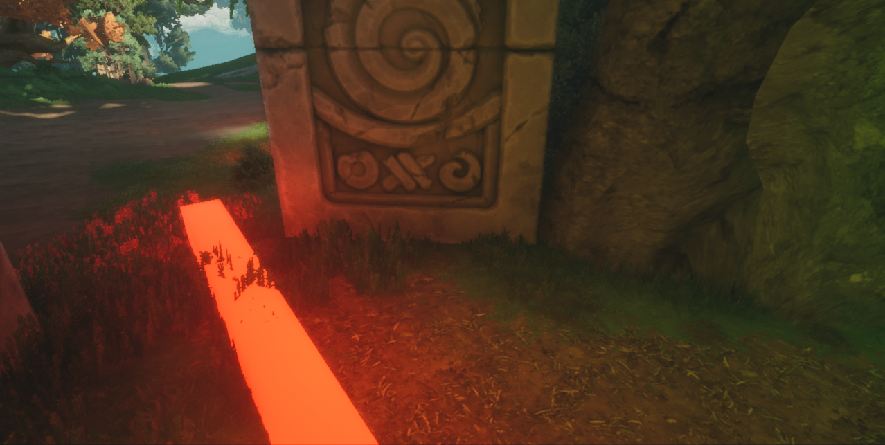

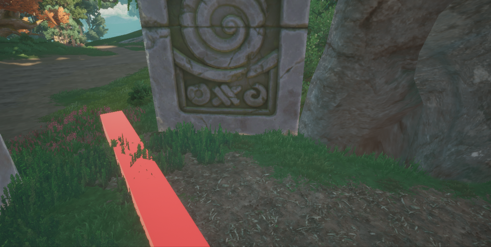

可以看下，GI局部传输矩阵大于1时，它的Local Ref 矩阵的可视化：

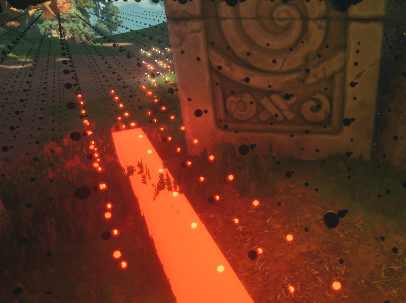

可以看到，它也是，发光的，表示它正在释放能量。

##   
6. 尾声

至此，我们已经可以看到了整个GI算法的完整面貌了，它的核性就是快速的构造Local Transfer Matrix，并在GPU上做类Bloom的Cache友好操作做GI的传输。整个算法，从头到尾都没有Trace（Ray cast）这也是这个算法为什么这么快最核心的原因。当然由于这样，也会造成很多问题。由于这种传输算法对空间的固定划分，我们会遇到漏光这样的问题。但是本算法的漏光会略好于一些如SDF DDGI，或者其他基于Probe类的GI。因为有一份原生的Local Visibility数据，以及比较完整的Global Visibility数据。但是漏光依旧，具体的处理方法，可以依据实际情况和需求具体来选择。

其次，对于一些细腻部位的反弹效果。可以看到这个算法的表现和Bloom的密度是相关的，类似于你用多大的Bloom texture。当然Diffuse GI我们普遍认为是偏低频的数据，因此稍微糊点可能不是那么严重，但是对于一些转角处的Diffuse其实还是偏高频的。这个可以两个角度来解决，目前整个算法0.5ms，在PC 1060上，差不多是0.06ms的开销，对于Console平台，可以把密度翻倍，可以达到非常细腻的一个间接阴影和间接光照。其次可以考虑融合一下SSGI，对高频部分会很有帮助。

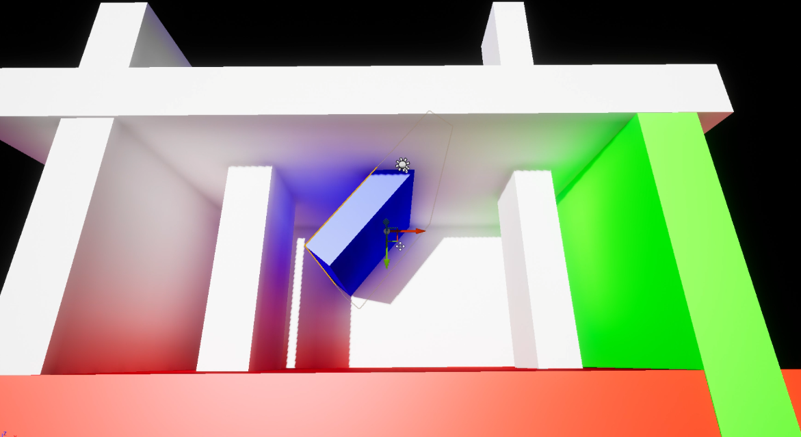

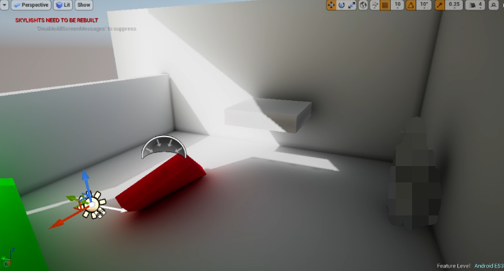

最后的最后，我还是想宣传一下 **胞胞机！** ！！！！！！！！！！！！！！！推荐大家看《A new kind of science》这本书，能给到很多启发

  

 **2023.12.21更新** 

GI 的实时Specular Reflection

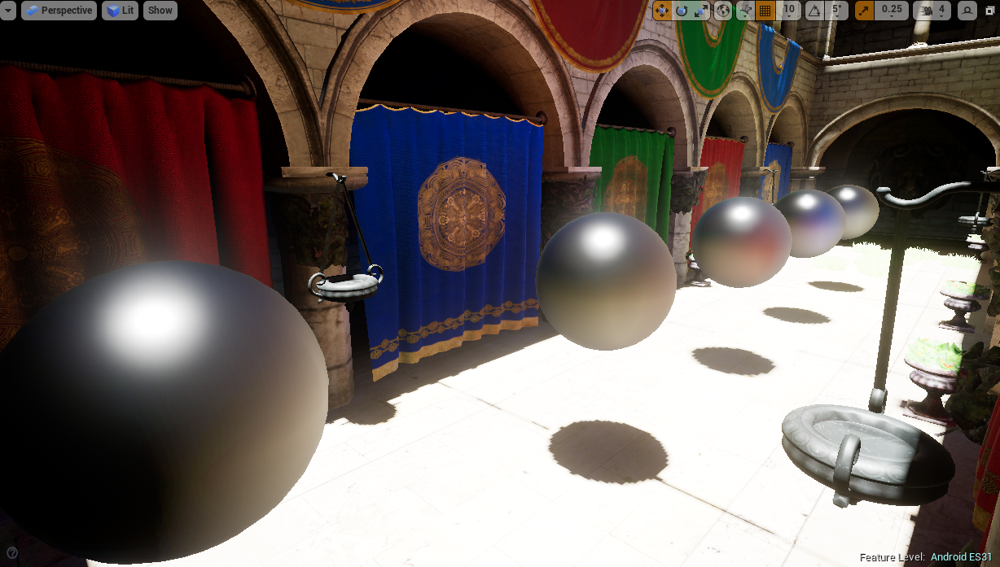

### 2024.3.25 更新

今天偶然看见Youtube上一个德国人，想到了和我一样的算法。哈哈

[https://www.youtube.com/watch?v=nNJG2GAHsQk](https://www.youtube.com/watch?v=nNJG2GAHsQk)

  

### 2024.4.xx 更新

今天心情不好，更新下局部反弹，就是前面的Local Transfer Matrix 的计算伪代码。

这个是计算局部一次反弹矩阵哒！

```cpp
//Input ColorToFill, is the voxel color, or sdf color , or one point of the local space color
float ColorToFillR
float ColorToFillG
float ColorToFillB

//SampleBasis is the direction from the center of local space to the ColorToFill
//GetSH2PIDivDFT is the function to calculate the SH basis function from a given direction. here is the direction to the color to fill
FSHVector2& BASH = SampleBasis;
FVector4 DA = GetSH2PIDivDFT(-SampleDir);
FVector4 DABA_x = DA * BASH.V[0];
FVector4 DABA_y = DA * BASH.V[1];
FVector4 DABA_z = DA * BASH.V[2];
FVector4 DABA_w = DA * BASH.V[3];

//TransferToWriteOut is the local transfer matrix, It has three Component, RGB foreach
//in a higher level usage of TransferToWriteOut is to make it ligher.
//eg: replace the RGB of transfer matrix to a Luminance Plus Color .
//the luminance take one 4x4 matrix and the color only take 3 8bit float

TransferToWriteOut.R.Factor0 += DABA_x * ColorToFillR;
TransferToWriteOut.R.Factor1 += DABA_y * ColorToFillR;
TransferToWriteOut.R.Factor2 += DABA_z * ColorToFillR;
TransferToWriteOut.R.Factor3 += DABA_w * ColorToFillR;

TransferToWriteOut.G.Factor0 += DABA_x * ColorToFillG;
TransferToWriteOut.G.Factor1 += DABA_y * ColorToFillG;
TransferToWriteOut.G.Factor2 += DABA_z * ColorToFillG;
TransferToWriteOut.G.Factor3 += DABA_w * ColorToFillG;

TransferToWriteOut.B.Factor0 += DABA_x * ColorToFillB;
TransferToWriteOut.B.Factor1 += DABA_y * ColorToFillB;
TransferToWriteOut.B.Factor2 += DABA_z * ColorToFillB;
TransferToWriteOut.B.Factor3 += DABA_w * ColorToFillB;

//here is the division of local transfer matrix factor. weight Sum is the number of ColorToFill we take.
//if one sample, it`s one, if 26 sample, it`s 26.
//float Factor = IL_PI4 / WeightSum; // we do importance sampling here
OutProbe.LocalVisibilitySH = OutProbe.LocalVisibilitySH * Factor;

//every sample point we take into consider need to add up. and multiply the factor
// build local PRT
{
	TransferToWriteOut.R.Factor0 *= Factor;
	TransferToWriteOut.R.Factor1 *= Factor;
	TransferToWriteOut.R.Factor2 *= Factor;
	TransferToWriteOut.R.Factor3 *= Factor;
	TransferToWriteOut.G.Factor0 *= Factor;
	TransferToWriteOut.G.Factor1 *= Factor;
	TransferToWriteOut.G.Factor2 *= Factor;
	TransferToWriteOut.G.Factor3 *= Factor;
	TransferToWriteOut.B.Factor0 *= Factor;
	TransferToWriteOut.B.Factor1 *= Factor;
	TransferToWriteOut.B.Factor2 *= Factor;
	TransferToWriteOut.B.Factor3 *= Factor;
}
```

然后我们可以通过这个求得局部小空间内的无穷次反弹：

```cpp
// The Local Reflection can be write as a inf series, while T is Local Reflection PRT Matrix 
// Than :
// InfBoundT = T + TT + TTT + TTTT + TTTTT .... T^n
// Follow with Neumann Law, a given A`s Neumann series : 
// I + A + AA + AAA + ... + A^n = (I - A)^-1
// than we can get:
// InfBoundT = (I - T)^-1 - I
// with such matrix, we can do Inf bound of local reflection in just one matrix mul!

这里就不放伪代码了，本质上就是使用Neumann Law 对上述矩阵求极限。求也可以，不求也可以。直接用上面的矩阵也可以。
之对收敛速度有微小影响。
```

### 最后，我想说说SH

 _如果没有实际深入使用过SH，可能很难对SH有个直观的理解。导致没法用好这个东西。_ 

首先我们先不管那些乱起八糟的公式。

记住

 **1阶SH ：float** 

 **2阶SH : float4** 

 **3阶SH ：float9** 

SH就是一个球面上的函数，就像你一个2维函数，3维函数一样。对于SH来说。你可以把一个分布在球面上的数据存储在SH里，然后你可以很快的用一个方向去取那个值。就像做Cubemap一样。或者，你就可以把SH当作是一个Cubemap。

SH的第0个系数，基本代表了这个SH的总能量。什么是总能量？总能量就是你球面上所有值都加起来的值。所以如何理解一个可见性SH。它的第0个系数代表了这个SH它是完全不可见，还是完全可见，还是在之间的某个状态。剩下3个分量代表了不同方向上对整个权重的分配。比如是右边更不可见，左边更可见一点还是怎样。

 **接下来，从做Shader的美术视角，我们就会遇到这样几个问题：** 

1.  怎么把Cubemap上每个点的值都加起来得到一个新的Cubemap。在SH上怎么做？
2.  怎么把Cubemap上每个点的值都乘起来得到一个新的Cubemap。在SH上怎么做？
3.  怎么算Cubemap上所有点的和。在SH上怎么做？
4.  balblabll

这就像是对于SH这个空间，你有哪些操作符，这些操作符，决定了它是不是好用，能不能方便解决某个问题。

 **首先SH有加法，也有乘法，但是没有除法。**  如果喜欢离散数学，那么这个应该算是群，还是环 还是域来着？它的操作符应该构成有限单群啥的？类似的意思。

 **SH的加法** 

就是直接相加。xyzw + xyzw = xyzw 。这样你就把两个cubemap加起来了。

乘法有点特殊，很多引擎和文献里都没有提到。它叫做SH Triple Product。 在研究量子物理的那边，经常用。

 **那乘法怎么做？** 

```text
half4 SHTripleProduct(half4 InSHA, half4 InSHB)
{
    half4 RetSH;
    RetSH.x = dot(InSHA, InSHB);
    RetSH.yzw = InSHA.xxx * InSHB.yzw + InSHB.xxx * InSHA.yzw;
    return RetSH * 0.28209479f;
}
```

这是我从一个量子力学的库里面总结出来的。就一个dot 加上 两个Mad

那积分(全部加起来求和)怎么做？

SH［0］ \* 3.5449077018110320545963349666823f; // 2 \* Sqrt(PI)

这就是积分。

## 2024.9.1 更新

### 来聊一聊局部传输矩阵Local Ref Matrix 的旋转

旋转局部传输矩阵涉及应用由 Wigner D-矩阵表示的旋转算子。以下是如何直接旋转矩阵  **B** ：

### 直接旋转局部传输矩阵  **B** 

### 概述

要在不重新构建的情况下旋转 局部传输 矩阵  **B** ：

 `!$B′=D⊤(R)⋅B⋅D(R)\mathbf{B}' = \mathbf{D}^\top(\mathbf{R}) \cdot \mathbf{B} \cdot \mathbf{D}(\mathbf{R})B′=D⊤(R)⋅B⋅D(R)$` 

其中：

-    **B**  是原始的 局部传输 矩阵（4x4）。
-    **B'**  是旋转后的 局部传输 矩阵。
-    `!$D(R)\mathbf{D}(\mathbf{R})D(R) $`  是对应于所需旋转  **R**  的 旋转算子。
-    `!$D⊤(R)\mathbf{D}^\top(\mathbf{R})D⊤(R)$`  是  `!$D(R)\mathbf{D}(\mathbf{R})D(R)$`  的转置矩阵，等同于  `!$D(R−1)\mathbf{D}(\mathbf{R}^{-1})D(R−1)$`  ，因为旋转算子是正交的。

### 详细步骤

1.   **构建 局部传输矩阵 旋转算子**   `!$D(R)\mathbf{D}(\mathbf{R})D(R)$`   **：**   
    

-   对于阶数  `!$ lmax=1l_{\text{max}} = 1lmax​=1$`  的 SH，总的 SH 系数数量为  `!$(lmax+1)2=4(l_{\text{max}} + 1)^2 = 4(lmax​+1)2=4$`  。
-   局部传输矩阵 旋转算子  `!$D(R)\mathbf{D}(\mathbf{R})D(R)$`  是一个块对角矩阵

1.   **计算旋转后的矩阵**   `!$B′\mathbf{B}'B′$`   **：**   
    

-   使用公式  `!$B′=D⊤(R)⋅B⋅D(R)\mathbf{B}' = \mathbf{D}^\top(\mathbf{R}) \cdot \mathbf{B} \cdot \mathbf{D}(\mathbf{R})B′=D⊤(R)⋅B⋅D(R)$`  。
-   这实际上是通过对输入和输出的 SH 系数应用旋转来旋转  **B**  描述的空间。

 **说人话就是，** 如果简单的把局部传输矩阵当作对于一个空间的描述，那么如果要旋转这个空间的出射光，需要首先对这个空间进行反向的旋转，这样我们可以从正确的位置接受入射光，其次我们需要把出射的光再正着旋转出去。因为这里用到的旋转矩阵就是普通的旋转矩阵，因此它的转置和它的逆等价。所以先乘旋转矩阵的转置，再乘局部传输矩阵，最后乘旋转矩阵。

当然，能这样算也是因为目前是SH2，恰巧有这种性质。如果是SH3的局部传输矩阵，旋转会异常复杂。

  

原文地址：[GI from Local Radiance Transfer——适合移动端上的0.5ms 全动态全...](https://zhuanlan.zhihu.com/p/653044045) 


# 评论


1. <a href="https://www.zhihu.com/people/ycz-19">ycz</a> (<small title="上海">2023-8-29 20:33:52</small>): 太牛了
2. <a href="https://www.zhihu.com/people/enron-fancy">大智</a> (<small title="浙江">2023-8-30 16:18:24</small>): 对于遮蔽的说法，是很正确的。只有少部分人意识到gi里让该暗的地方暗下去有多么重要。
   - **橙子** (<small title="广东">2023-8-30 17:0:49</small>): 甚至比反弹重要，而且遮蔽计算开销是反弹的1/3
3. <a href="https://www.zhihu.com/people/kyrie_1">Kyrie</a> (<small title="广东">2023-8-29 20:18:5</small>): [更新踢我](https://pica.zhimg.com/v2-d7cca5a4619445f202921e590a70ee73.gif?source=1d2f5c51)
   - **橙子** (<small title="广东">2023-8-30 17:57:43</small>): 踢
   - <a href="https://www.zhihu.com/people/kyrie_1">Kyrie</a> (<small title="回复于 2023-8-30 18:8:19/广东"> ✉️:橙子</small>): 已阅［可怜］求更新再踢
   - **橙子** (<small title="回复于 2023-8-31 15:15:15/广东"> ✉️:Kyrie</small>): 踢
   - <a href="https://www.zhihu.com/people/kyrie_1">Kyrie</a> (<small title="回复于 2023-8-31 15:24:2/广东"> ✉️:橙子</small>): 再蹲［蹲］［蹲］
   - **橙子** (<small title="回复于 2023-9-6 18:10:9/广东"> ✉️:Kyrie</small>): 再踢
   - <a href="https://www.zhihu.com/people/kyrie_1">Kyrie</a> (<small title="回复于 2023-9-6 19:21:13/广东"> ✉️:橙子</small>): [涨知识了](https://picx.zhimg.com/v2-da2e791835353bb9ac70900d00b4f5da.gif?source=1d2f5c51)
   - **橙子** (<small title="回复于 2023-9-15 19:22:1/广东"> ✉️:Kyrie</small>): 再踢
4. <a href="https://www.zhihu.com/people/a_nonymous">一只狗</a> (<small title="广东">2023-10-11 15:29:32</small>): 大佬太牛了，带带弟弟，已经点赞。
5. <a href="https://www.zhihu.com/people/hei-tao-qi-57">黑桃七</a> (<small title="广东">2023-8-31 10:13:37</small>): 催更［大哭］
   - **橙子** (<small title="广东">2023-8-31 15:15:10</small>): 踢
   - <a href="https://www.zhihu.com/people/hei-tao-qi-57">黑桃七</a> (<small title="回复于 2023-8-31 19:3:54/广东"> ✉️:橙子</small>): 1， 再蹲［大哭］
   - **橙子** (<small title="回复于 2023-9-6 18:10:17/广东"> ✉️:黑桃七</small>): 再踢
   - **橙子** (<small title="回复于 2023-9-15 19:22:11/广东"> ✉️:黑桃七</small>): 再踢
   - <a href="https://www.zhihu.com/people/hei-tao-qi-57">黑桃七</a> (<small title="回复于 2023-9-15 20:52:18/广东"> ✉️:橙子</small>): 效果真好［大哭］
6. <a href="https://www.zhihu.com/people/lu-han-yang-62">v4vendeta</a> (<small title="广东">2024-3-11 20:3:16</small>): 会在gdc讲吗，是哪个议题呀
   - **橙子** (<small title="广东">2024-3-11 20:7:54</small>): 不去了。去不了了［可怜］
7. <a href="https://www.zhihu.com/people/jiu-shi-wo-a-3-7">迁佰</a> (<small title="天津">2024-2-28 17:19:35</small>): 姐你的论证无限次数反弹的部分呢？我记得有啊，是太过机密被你删掉了么？
   - **橙子** (<small title="广东">2024-2-28 20:39:5</small>): 昂，是
   - <a href="https://www.zhihu.com/people/jiu-shi-wo-a-3-7">迁佰</a> (<small title="回复于 2024-2-29 10:29:20/北京"> ✉️:橙子</small>): 😭
   - <a href="https://www.zhihu.com/people/81-90-22-77">知乎用户OMto9b</a> (<small title="回复于 2024-8-5 9:11:54/福建"> ✉️:橙子</small>): 女生！！！！？［发呆］牛逼
   - <a href="https://www.zhihu.com/people/ren-gong-zhi-zhang-36">连接成功</a> (<small title="回复于 2024-12-25 10:7:20/贵州"> ✉️:知乎用户OMto9b</small>): 我说这文章咋一股女子气［捂脸］
8. <a href="https://www.zhihu.com/people/deku-55-37">insulation</a> (<small title="天津">2023-9-17 10:1:28</small>): 这个[干涉条纹](https://www.zhihu.com/search?comment_id=10681436285&comment_type=COMMENT&content_id=233249835&content_type=article&q=%E5%B9%B2%E6%B6%89%E6%9D%A1%E7%BA%B9&request_click_id=6416f7c2-0869-49d0-a61f-af92fa4b3fa3&search_source=CommentEntity)明显就是某种原因产生的artifact吧，而不是什么波动光学［捂脸］
   - **橙子** (<small title="广东">2023-9-18 10:28:3</small>): 那个波是。条纹应该是注入shadow map的bias
9. <a href="https://www.zhihu.com/people/puzzledboy">PZZZB</a> (<small title="广东">2023-8-30 10:41:19</small>): Mark TQL等一个更新
10. <a href="https://www.zhihu.com/people/18392006811">withanorchid</a> (<small title="浙江">2026-9-20 16:41:22</small>): 请问文中预计算类下面所说的Local Radiance Probe具体是指哪一项技术呀
11. <a href="https://www.zhihu.com/people/seedzy">seedzy</a> (<small title="四川">2026-8-6 18:1:10</small>): 姐啊，CPU侧的Local Transfer Matrix构造的时候如果一个trunk 8\*8\*8个probe而trunk内物体又太多，每个probe还要取周围26个邻接信息，不会有性能问题吗
12. <a href="https://www.zhihu.com/people/wu-li-71-77">无理</a> (<small title="江苏">2026-6-8 23:31:44</small>): 我也想加入胞胞机教，大佬［哇］
13. <a href="https://www.zhihu.com/people/tiaozi-11">tiao子</a> (<small title="上海">2026-1-20 20:23:4</small>): 想加入胞胞自动机教
14. <a href="https://www.zhihu.com/people/qiang-xiao-tou-ming">勥小透明</a> (<small title="北京">2026-1-15 17:8:27</small>): 这个是 GDC 2023 上的那个 HSGI 吗？
15. <a href="https://www.zhihu.com/people/98-63-58-66-3">雨女无瓜</a> (<small title="四川">2026-1-13 10:9:40</small>): ColorSDF除了用于颜色计算，还用于调整Probe的位置吗？原理跟SDFGI是否相像？
16. <a href="https://www.zhihu.com/people/tiaozi-11">tiao子</a> (<small title="上海">2025-12-3 15:9:56</small>): 请教一下，LocalVisibility是怎么得到的
17. <a href="https://www.zhihu.com/people/liu-han-yang">刘瀚阳</a> (<small title="广东">2025-6-13 9:13:10</small>): 大佬太强了
18. <a href="https://www.zhihu.com/people/bing-feng-ruo-qian">若小仟</a> (<small title="广西">2025-4-13 20:33:46</small>): 如何加入 胞胞自动机教？［害羞］
19. <a href="https://www.zhihu.com/people/mushroom94">nekobus</a> (<small title="上海">2025-2-27 17:56:19</small>): 好可爱
20. <a href="https://www.zhihu.com/people/liu-mang-81-45">阳光伤了狗眼</a> (<small title="广东">2024-12-3 20:6:35</small>): 先收藏了，有空尝试复现一下，给大佬先跪了
    - **橙子** (<small title="广东">2024-12-3 21:7:41</small>): 别跪🥺
21. <a href="https://www.zhihu.com/people/pan-da-98-2">潘达</a> (<small title="北京">2024-12-1 13:47:58</small>): 胞胞机好评！如何入教！
    - **橙子** (<small title="广东">2024-12-3 20:38:10</small>): 看a new kind of science。这个是我们教的圣经
    - <a href="https://www.zhihu.com/people/pan-da-98-2">潘达</a> (<small title="回复于 2024-12-3 20:51:31/北京"> ✉️:橙子</small>): 里面东西太多了，最近还看[Wolfram](https://www.zhihu.com/search?comment_id=11056233510&comment_type=COMMENT&content_id=233249835&content_type=article&parent_comment_id=11054408307&q=Wolfram&request_click_id=e92d9d97-2af6-4f97-8be0-7058c8b7cfc5&search_source=CommentEntity)从里面拔东西给大家科普
    - **橙子** (<small title="回复于 2024-12-3 21:7:23/广东"> ✉️:潘达</small>): 🥺那你要加入胞胞机教吗！快私信我
22. <a href="https://www.zhihu.com/people/egg-52">rgbflux</a> (<small title="北京">2024-12-1 9:22:30</small>): probe类算法普遍存在的漏光问题是怎么解决的呢？如果是类似ddgi的方案会导致边角很黑或者阴影不均匀
23. <a href="https://www.zhihu.com/people/ray-12-7">Tryzr</a> (<small title="上海">2024-9-28 11:58:39</small>): 光源注入时的阴影是用[shadowmap](https://www.zhihu.com/search?comment_id=11003632164&comment_type=COMMENT&content_id=233249835&content_type=article&q=shadowmap&request_click_id=2a66432b-88cf-4880-8e0e-69dfa1e24441&search_source=CommentEntity)吗，还是sdf raymarch？
    - **橙子** (<small title="广东">2024-9-28 12:35:36</small>): shadow map
    - <a href="https://www.zhihu.com/people/ray-12-7">Tryzr</a> (<small title="回复于 2024-9-28 17:25:58/江苏"> ✉️:橙子</small>): 感谢，还有一个不大了解的，在构建local transfer matrix时的每一个probe是要乘算一个平方反比衰减吧？
    - **橙子** (<small title="回复于 2024-9-28 21:34:55/广东"> ✉️:Tryzr</small>): 不用的。构造那个矩阵不需要这个。
    - <a href="https://www.zhihu.com/people/ray-12-7">Tryzr</a> (<small title="回复于 2024-9-28 22:0:16/湖北"> ✉️:橙子</small>): 明白了，那简单混合就可以了
    - **橙子** (<small title="广东">2024-9-29 18:59:27</small>): 为啥传不远呀，就是标准的辐射计算呀
    - <a href="https://www.zhihu.com/people/ray-12-7">Tryzr</a> (<small title="回复于 2024-9-29 19:35:56/湖北"> ✉️:橙子</small>): 解决了，是我理解错了
    - **橙子** (<small title="回复于 2024-9-29 19:50:15/广东"> ✉️:Tryzr</small>): 🌝复现好了给我看看
    - <a href="https://www.zhihu.com/people/ray-12-7">Tryzr</a> (<small title="回复于 2024-9-30 16:16:24/湖北"> ✉️:橙子</small>): 好的好的
24. <a href="https://www.zhihu.com/people/b1ggrandpa">喜欢毛米</a> (<small title="广东">2024-8-31 2:57:24</small>): 好强！所以胞胞机是一种类似LBM的东西吗［思考］
    - **橙子** (<small title="四川">2024-8-31 14:39:27</small>): 😈大胆。胞胞机就是万物的神，怎么可以把胞胞机大人和其他算法相提并论！
25. <a href="https://www.zhihu.com/people/alin-90-68-39">请将我幻葬</a> (<small title="广东">2024-8-14 22:53:34</small>): 妹纸在哪里工作呀［可怜］
    - **橙子** (<small title="广东">2024-8-15 13:47:31</small>): 腾腾讯讯
    - <a href="https://www.zhihu.com/people/alin-90-68-39">请将我幻葬</a> (<small title="回复于 2024-8-15 16:9:36/上海"> ✉️:橙子</small>): emmm没听说过这个公司［可怜］
    - **橙子** (<small title="回复于 2024-8-31 14:39:54/四川"> ✉️:请将我幻葬</small>): 讯腾
    - **橙子** (<small title="回复于 2024-8-31 14:40:13/四川"> ✉️:请将我幻葬</small>): ［可怜］
26. <a href="https://www.zhihu.com/people/zhe-ni-du-bu-zhi-dao">这你都不知道</a> (<small title="广东">2024-4-18 11:29:20</small>): 感谢大佬分享，GetSH2PIDivDFT(-SampleDir)这个SampleDir是center of local space to ColorToFill的方向吗？这个函数没明白是做什么
    - **橙子** (<small title="广东">2024-4-18 14:17:22</small>): 是的，是这个方向。这个函数是用来求diffuse传输的
    - <a href="https://www.zhihu.com/people/zhe-ni-du-bu-zhi-dao">这你都不知道</a> (<small title="回复于 2024-4-20 13:15:3/广东"> ✉️:橙子</small>): 感谢！
27. <a href="https://www.zhihu.com/people/kun-peng-13-14">鲲鹏</a> (<small title="广东">2024-4-15 11:37:59</small>): 感谢分享，请问有个人项作品的体验或者demo体验吗？鉴于要实现一整套的GI需要很多辅助工具，体验Demo可以直观了解这个方案的适用性，如果能发布一两个让大家测试下的demo更佳
    - **橙子** (<small title="四川">2024-8-31 14:41:11</small>): 没有(\*^ω^\*)，不过有大佬已经复现了，可以找大佬要他们复现的。
    - <a href="https://www.zhihu.com/people/ao-ta-kang-007">奥塔康007</a> (<small title="回复于 2026-1-11 22:4:29/上海"> ✉️:橙子</small>): 哪个？我过去看看［大笑］
    - <a href="https://www.zhihu.com/people/ccoore">ccoore</a> (<small title="回复于 2026-4-14 11:32:4/广东"> ✉️:橙子</small>): 插眼求一个demo
28. <a href="https://www.zhihu.com/people/ru-he-rang-hai-zi-ai-shang-xue-xi">全桥整流器</a> (<small title="北京">2024-2-21 2:29:15</small>): 逐物件的precomputed local transfer matrix一个物件可以分配多个吗，最后probe上直接加不需要考虑位置吗，求老师解答
    - **橙子** (<small title="广东">2024-2-21 12:56:9</small>): 可以分配多个，直接加要看你是什么分配方式了。如果重叠是可以直接加，否则需要做投影，不过不做，问题也不是很大。
    - <a href="https://www.zhihu.com/people/ru-he-rang-hai-zi-ai-shang-xue-xi">全桥整流器</a> (<small title="北京">2024-2-21 13:23:53</small>): 感谢大佬解答！我理解的precomputed local transfer matrix就是像prt的探针那样从不同位置向四面八方拍个照获取物件的局部数据，然后多个matrix合并得到完整的物体数据。这样的话似乎只能用多个matrix表达一个物体。还是说有什么办法可以只用一个matrix就能表达一个物件？
    - **橙子** (<small title="回复于 2024-2-21 17:22:24/广东"> ✉️:全桥整流器</small>): 这个没办法啦如果特别远可以用一个matrix。不过这种情况没啥收益
29. <a href="https://www.zhihu.com/people/51-46-8-72">陆野Luye</a> (<small title="上海">2024-1-25 17:10:9</small>): 太强了，加入胞胞机教就可以学会吗
    - **橙子** (<small title="广东">2024-1-25 19:6:33</small>): 嗯呐
30. <a href="https://www.zhihu.com/people/xiang-ge-ban-shi">WeebOwO</a> (<small title="天津">2024-1-19 20:48:49</small>): 太强了
31. <a href="https://www.zhihu.com/people/jin-fu-li-ke-si">金-富力克斯</a> (<small title="四川">2024-1-16 11:37:9</small>): 想问下最后的环境反射探针也是通过二阶球谐还原的吗？但是那样的话不是就不适合特别光滑的物体了。。［思考］
    - **橙子** (<small title="四川">2024-8-31 14:42:1</small>): 是滴。反射做不好［可怜］
32. <a href="https://www.zhihu.com/people/da-bing-zai-ci">DabingHere</a> (<small title="山东">2023-12-23 2:56:37</small>): 思路太牛逼了，牛逼！这得吃多少[元胞自动机](https://www.zhihu.com/search?comment_id=10758445385&comment_type=COMMENT&content_id=233249835&content_type=article&q=%E5%85%83%E8%83%9E%E8%87%AA%E5%8A%A8%E6%9C%BA&request_click_id=dc3516cb-6ba6-4cca-8e90-a0b97cec6333&search_source=CommentEntity)才能想出来啊［大哭］
33. <a href="https://www.zhihu.com/people/chenq-38">自然</a> (<small title="广东">2023-12-10 13:0:1</small>): ［微笑］
34. <a href="https://www.zhihu.com/people/jin-fu-li-ke-si">金-富力克斯</a> (<small title="四川">2023-11-14 13:21:34</small>): 有个比较疑惑的工程问题，想问下大佬。我还是想把场景当作一个静态物体来做,在伪代码那里IncomingLight那里的话，假设直接添加上直接光SH、点光源SH后，按道理来说应该进行IncomingLight = Trpd(IncomingLight,ShadowSH)吧，但是这样就需要提前预烘焙24小时的ShadowSH(带昼夜的话)。但是如果不用ShadowSH的话，直接采样ShadowMap来取阴影遮蔽的话，快速晃动镜头的话会不会闪烁，特别是针对类似于GpuDriven这种自定义阴影裁剪的部分，可能镜头背后部分的阴影就被裁剪掉了，导致镜头背后探针取ShadowMap的值可能会有问题，镜头转过来的话光照传输不及时的话按理来说会闪烁吧。
    - **橙子** (<small title="广东">2023-11-14 15:40:37</small>): 会cache之前的状态的呀
    - <a href="https://www.zhihu.com/people/jin-fu-li-ke-si">金-富力克斯</a> (<small title="回复于 2023-11-14 16:11:29/四川"> ✉️:橙子</small>): 那假设没有cache住的话，一开始晃动镜头的话还是会闪烁吧。
    - <a href="https://www.zhihu.com/people/jin-fu-li-ke-si">金-富力克斯</a> (<small title="回复于 2023-11-14 16:16:35/四川"> ✉️:橙子</small>): 而且假设光照是带昼夜的话，光照的阴影是会一直变的，比如在原地停留一会儿再动的话，可能它的阴影遮蔽状态就变了，然后我一晃动视角的话，这个探针的阴影遮蔽信息就不是处于cache状态部分，我的意思就是对于经常第一次就刷新阴影遮蔽的话，它的闪烁情况会不会比较严重。
    - **橙子** (<small title="广东">2023-11-14 16:52:53</small>): 没有烘焙24小时的呀。
    - **橙子** (<small title="广东">2023-11-14 16:53:8</small>): 也没有存Shadow sh
    - **橙子** (<small title="回复于 2023-11-14 16:53:56/广东"> ✉️:金-富力克斯</small>): 这个不会，gi本身更新就有延迟，很像lumen那种样子
    - <a href="https://www.zhihu.com/people/jin-fu-li-ke-si">金-富力克斯</a> (<small title="回复于 2023-11-14 16:56:24/四川"> ✉️:橙子</small>): 我知道你那边没有用ShadowSH,我只是把这个当作备用方案。我只是想问那个初次闪烁是否严重。［笑哭］
    - <a href="https://www.zhihu.com/people/jin-fu-li-ke-si">金-富力克斯</a> (<small title="回复于 2023-11-14 17:1:23/四川"> ✉️:橙子</small>): 就比如说我用的是虚拟纹理阴影的话，对于视锥体内的探针取阴影状态的话，那么这个探针的Cache的阴影遮蔽是正确的，但是对于视锥体背后的话，我的虚拟纹理阴影未必有正确的阴影遮蔽供背后的探针进行采样，所以再加上昼夜变化的话，一下子旋转镜头的话，有些探针的阴影遮蔽状态就是初始刷新的，我就想知道这种第一次刷新时闪烁情况怎么样的。。。
    - **橙子** (<small title="回复于 2023-11-14 17:42:1/广东"> ✉️:金-富力克斯</small>): 没有见到过呀
    - **橙子** (<small title="回复于 2023-11-14 17:42:12/广东"> ✉️:金-富力克斯</small>): 不严重呀。看不出来
    - <a href="https://www.zhihu.com/people/jin-fu-li-ke-si">金-富力克斯</a> (<small title="回复于 2023-11-14 19:30:33/四川"> ✉️:橙子</small>): 好的，谢谢大佬解惑
    - **橙子** (<small title="回复于 2023-11-15 13:51:47/广东"> ✉️:金-富力克斯</small>): 不是大佬啦
    - <a href="https://www.zhihu.com/people/jin-fu-li-ke-si">金-富力克斯</a> (<small title="回复于 2023-11-16 9:26:33/四川"> ✉️:橙子</small>): 大佬，求一下GI推导过程，已私聊。［拜托］
35. <a href="https://www.zhihu.com/people/rockwu-80">Maxmini</a> (<small title="四川">2023-11-8 12:44:44</small>): 注入[点光源](https://www.zhihu.com/search?comment_id=10723422712&comment_type=COMMENT&content_id=233249835&content_type=article&q=%E7%82%B9%E5%85%89%E6%BA%90&request_click_id=dc3516cb-6ba6-4cca-8e90-a0b97cec6333&search_source=CommentEntity)的时候有考虑阴影么，还是说在光源范围里就直接算，主要是之前的那份遮蔽数据应该是算不了点光源的吧
    - **橙子** (<small title="广东">2023-11-8 16:14:24</small>): 有考虑的，会考虑阴影
    - <a href="https://www.zhihu.com/people/rockwu-80">Maxmini</a> (<small title="回复于 2023-11-8 16:23:53/四川"> ✉️:橙子</small>): 怎么做呢，直接注入到光源周围的一圈probe，之后靠传递么
    - **橙子** (<small title="回复于 2023-11-8 19:30:27/广东"> ✉️:Maxmini</small>): 点光是这样做的
36. <a href="https://www.zhihu.com/people/duan-ke-yu-99-28">段科宇</a> (<small title="北京">2023-10-26 18:47:19</small>): 大佬求推导过程
    - **橙子** (<small title="广东">2023-10-26 22:28:21</small>): 私聊我哦
    - <a href="https://www.zhihu.com/people/duan-ke-yu-99-28">段科宇</a> (<small title="回复于 2023-10-27 9:50:33/北京"> ✉️:橙子</small>): 已私信
    - <a href="https://www.zhihu.com/people/wen-zi-yu-zhi-hu">知乎用户</a> (<small title="回复于 2023-11-6 16:0:48/上海"> ✉️:橙子</small>): 大佬，同求［大哭］高估自己了
    - **橙子** (<small title="回复于 2023-11-6 17:5:20/广东"> ✉️:知乎用户</small>): 私聊我哦
    - <a href="https://www.zhihu.com/people/a_nonymous">一只狗</a> (<small title="回复于 2023-11-22 15:53:5/广东"> ✉️:段科宇</small>): 大佬同求，高估自己了
37. <a href="https://www.zhihu.com/people/gong-shui-san-ye-78-72">TinyBookE</a> (<small title="浙江">2023-10-25 10:57:51</small>): 纯小白，请问大佬几个问题，希望不吝赐教［大哭］<div><br></div>probe in shadow的时候InComingLight += 方向光的意思其实是不在阴影里才加上方向光吗？之前那段得到无限反射的InfRef被删掉了，是因为这个其实不必要吗，直接用单次反射的LocalMatrix做全局传输就已经是达到了无限反射的效果吗？从逐物体的GI Primitive生成Probe的LocalMatrix，然后再把有值的Probe传到GPU上做传输，我这么理解整体流程对吗？怎么获取邻接的GI Primitive没看懂，直接从当前Trunk的Primitive List里顺序查找最近的26个GI Primitive吗？
    - <a href="https://www.zhihu.com/people/gong-shui-san-ye-78-72">TinyBookE</a> (<small title="浙江">2023-10-25 10:58:25</small>): 欸，怎么123的标号没了［大哭］变得好乱
38. <a href="https://www.zhihu.com/people/wen-zi-yu-zhi-hu">知乎用户</a> (<small title="上海">2023-10-23 12:42:41</small>): 大佬太强了。
39. <a href="https://www.zhihu.com/people/illmew">Catddly</a> (<small title="广东">2023-10-12 12:22:54</small>): mark
40. <a href="https://www.zhihu.com/people/lxyla-la-la-35">LietL</a> (<small title="福建">2023-10-12 14:26:16</small>): 有更新求踢一下
    - **橙子** (<small title="广东">2023-10-12 14:27:11</small>): 好嘞
41. <a href="https://www.zhihu.com/people/rockwu-80">Maxmini</a> (<small title="四川">2023-9-28 16:37:47</small>): 大佬现在支持物体bake之后在场景里旋转么
    - **橙子** (<small title="广东">2023-9-28 17:52:57</small>): 支持，但是有拖影
42. <a href="https://www.zhihu.com/people/iiley">iiley</a> (<small title="广东">2023-9-28 9:53:6</small>): 请问大佬，会出一个开源的unity实现吗？
43. <a href="https://www.zhihu.com/people/xiao-ya-70-28">小涯</a> (<small title="北京">2023-9-19 11:36:31</small>): 大佬，[DFT](https://www.zhihu.com/search?comment_id=10682943720&comment_type=COMMENT&content_id=233249835&content_type=article&q=DFT&request_click_id=58a8e7dd-164f-4861-a223-e28d87214f94&search_source=CommentEntity)这项是干啥的，没看太看懂
    - <a href="https://www.zhihu.com/people/xiao-ya-70-28">小涯</a> (<small title="北京">2023-9-19 11:40:3</small>): 对于diffuse来说，[brdf](https://www.zhihu.com/search?comment_id=10683179308&comment_type=COMMENT&content_id=233249835&content_type=article&parent_comment_id=10682943720&q=brdf&request_click_id=44fdbd51-cdb8-45ce-837e-6dbc362ab58c&search_source=CommentEntity)为常数，是不是等于cos theta，那他的2阶sh表示怎么推出来的
    - **橙子** (<small title="广东">2023-9-19 14:59:15</small>): 嗯嗯就是diffuse。你说的是哪个？
    - <a href="https://www.zhihu.com/people/xiao-ya-70-28">小涯</a> (<small title="回复于 2023-9-19 22:3:18/北京"> ✉️:橙子</small>): 就是dft 那项是cos theta的球谐展开嘛
    - **橙子** (<small title="回复于 2023-9-19 22:21:8/广东"> ✉️:小涯</small>): 嗯嗯
    - <a href="https://www.zhihu.com/people/xiao-ya-70-28">小涯</a> (<small title="河南">2023-9-23 15:39:28</small>): 大佬，我又仔细看了下，没做过这些的小白有些问题得空能帮忙解答下不～  <div><br></div>1、对于每个物体，是不是也是以1m为单位烘了多个local transfer matrix  <div><br></div>2、每个trunk里面的物体发生变化，是不是需要重新生成这个trunk的所有probe的local transfer matrix和visibility的sh信息，这块的构造应该都是在cpu上吧。  <div><br></div>3、整个场景是使用的一个bloom texture嘛，每个trunk是不是对应bloom texture的中间一块切片  <div><br></div>4、平行光的处理可以再多解释下嘛，为啥伪代码里in shadow时会加平行光的sh，平行光的sh咋计算  <div><br></div>5、如果一个trunk物体发生变化，那生成的全局传输信息是不是就无效了，这种情况分帧咋处理呢
    - **橙子** (<small title="回复于 2023-9-24 9:49:6/广东"> ✉️:小涯</small>): 1,2,3理解的都没有错。4的话就是把平行光用sh表示一下。5的话，也不能说叫无效。只能说是场景变化了。只要正常更新就会慢慢变成新的正确的啦
    - <a href="https://www.zhihu.com/people/xiao-ya-70-28">小涯</a> (<small title="回复于 2023-9-24 12:6:57/湖南"> ✉️:橙子</small>): 好的，多谢大佬［赞同］
44. <a href="https://www.zhihu.com/people/kong-ling-hang-10">孔令航</a> (<small title="四川">2023-9-17 19:9:47</small>): ［爱］赞
45. <a href="https://www.zhihu.com/people/dcoding-42">KaiGe</a> (<small title="上海">2023-9-15 21:8:15</small>): 太厉害了［赞］
46. <a href="https://www.zhihu.com/people/jin-fu-li-ke-si">金-富力克斯</a> (<small title="四川">2023-9-15 17:16:27</small>): 想问下大佬探针中光照注入的DirectionalLightSH是怎么算的，难道是像prt那样预计算mini-Gbuffer然后还原直接光Buffer然后再CubeMap转成SH吗？［思考］
    - **橙子** (<small title="广东">2023-9-15 18:23:51</small>): 方向光sh乘那个局部传输矩阵
    - **橙子** (<small title="广东">2023-9-15 18:29:58</small>): 就是4x4矩阵乘4x1向量
    - <a href="https://www.zhihu.com/people/jin-fu-li-ke-si">金-富力克斯</a> (<small title="回复于 2023-9-15 19:39:41/四川"> ✉️:橙子</small>): 想问的是方向光SH怎么求。。［好奇］
    - <a href="https://www.zhihu.com/people/jin-fu-li-ke-si">金-富力克斯</a> (<small title="回复于 2023-9-15 20:24:14/四川"> ✉️:橙子</small>): 是这个算的吗，方向光SH = [DFT](https://www.zhihu.com/search?comment_id=10680439980&comment_type=COMMENT&content_id=233249835&content_type=article&parent_comment_id=10679888653&q=DFT&request_click_id=089834a3-8ade-4bc7-9431-c65946cebe1c&search_source=CommentEntity)(光源方向)\*BasisSH(光源方向)\*光源颜色单通道
    - **橙子** (<small title="回复于 2023-9-15 22:46:39/广东"> ✉️:金-富力克斯</small>): 噢噢。这个🌚是有[解析解](https://www.zhihu.com/search?comment_id=10680444413&comment_type=COMMENT&content_id=233249835&content_type=article&parent_comment_id=10679888653&q=%E8%A7%A3%E6%9E%90%E8%A7%A3&request_click_id=089834a3-8ade-4bc7-9431-c65946cebe1c&search_source=CommentEntity)的。就一个方向的基乘下强度
    - <a href="https://www.zhihu.com/people/jin-fu-li-ke-si">金-富力克斯</a> (<small title="回复于 2023-9-16 8:39:20/四川"> ✉️:橙子</small>): 喔喔 谢谢大佬
47. <a href="https://www.zhihu.com/people/xing-ru-mo-nian">行莫如年</a> (<small title="重庆">2023-9-13 14:39:6</small>): 想问问对SH做Triple Product是什么运算呀？混合积？还是直接逐个SH系数的乘法呀？
    - **橙子** (<small title="广东">2023-9-13 14:46:34</small>): 是积，不是系数乘
    - <a href="https://www.zhihu.com/people/xing-ru-mo-nian">行莫如年</a> (<small title="回复于 2023-9-13 14:59:44/重庆"> ✉️:橙子</small>): 原来如此，多谢大佬，但是四维向量的叉乘不是为0么
    - **橙子** (<small title="回复于 2023-9-13 16:13:31/广东"> ✉️:行莫如年</small>): sh不是这样算哒
    - <a href="https://www.zhihu.com/people/xing-ru-mo-nian">行莫如年</a> (<small title="回复于 2023-9-13 17:41:15/重庆"> ✉️:橙子</small>): 好吧，谢谢美女姐姐祝上班摸鱼愉快［酷］
    - **橙子** (<small title="回复于 2023-9-13 18:0:23/广东"> ✉️:行莫如年</small>): 形象点就是类似于两个球，球上的每个点位置纯的数相乘变成一个新的球
    - **橙子** (<small title="广东">2024-5-24 7:41:12</small>): 我更新了sh怎么算
48. <a href="https://www.zhihu.com/people/enron-fancy">大智</a> (<small title="浙江">2023-9-12 10:26:1</small>): 你的全局可见性的传输视频呢［滑稽］
    - **橙子** (<small title="广东">2023-9-12 12:54:35</small>): 我录，等我录［害羞］
49. <a href="https://www.zhihu.com/people/jhohkkk">Jhohkkk</a> (<small title="北京">2023-9-10 11:51:53</small>): 我之前看过mc实现接触阴影，ao那块，其实有其他做法，因为是规则的体素单元，甚至不需要什么渲染算法，单纯从几何空间去做的，结果是几乎没太大区别，而实时shading基本没开销。移动端gpu的确算力还可以，但是功耗问题很难把控，马力全开跑前10分钟还好，一旦降频帧率回到改革开放前。。。［可怜］
    - <a href="https://www.zhihu.com/people/wumoyany">Lumos</a> (<small title="广东">2023-9-10 21:58:46</small>): 好在这个算法可以通过分帧的方式控制消耗，在效果延迟与功耗时间取舍。
    - <a href="https://www.zhihu.com/people/jhohkkk">Jhohkkk</a> (<small title="回复于 2023-9-11 18:27:3/北京"> ✉️:Lumos</small>): 坐等后续［酷］
    - <a href="https://www.zhihu.com/people/lxyla-la-la-35">LietL</a> (<small title="福建">2023-12-6 17:57:21</small>): mc接触阴影和Ao这一块的文章能分享一下嘛 一直没找到
    - <a href="https://www.zhihu.com/people/jhohkkk">Jhohkkk</a> (<small title="回复于 2023-12-6 20:30:40/北京"> ✉️:LietL</small>): [https://0fps.net/2013/07/03/ambient-occlusion-for-minecraft-like-worlds/](https://0fps.net/2013/07/03/ambient-occlusion-for-minecraft-like-worlds/)
50. <a href="https://www.zhihu.com/people/LeviaThAN">LeviaThAN</a> (<small title="浙江">2023-9-9 17:36:37</small>): 大佬啥时候出下一篇（搓手手
    - **橙子** (<small title="广东">2023-9-9 22:31:28</small>): （尖叫
    - <a href="https://www.zhihu.com/people/LeviaThAN">LeviaThAN</a> (<small title="回复于 2023-9-10 16:0:40/上海"> ✉️:橙子</small>): （继续等ing［害羞］
51. <a href="https://www.zhihu.com/people/wang-yudong">我就看看</a> (<small title="北京">2023-9-8 11:11:6</small>): 很强，哈哈，能透露一下gdc上的哪个演讲嘛？去膜拜一下
52. <a href="https://www.zhihu.com/people/qq930475233">Dawncxzz</a> (<small title="广东">2023-9-4 17:39:22</small>): 全局传输的计算的时候，不是也要基本每个probe去计算参与传输吗，这部分消耗没懂
    - **橙子** (<small title="广东">2023-9-4 17:59:57</small>): 传输开销占整个算法的80%
    - **橙子** (<small title="广东">2023-9-4 17:59:2</small>): 是的，开销要。但是因为是邻接probe传输内存上cache友好。同时可以做分帧。其次传输计算量类似算bloom，最后比如一个64\*64\*64的体纹理，相当于对一个1024＊64的纹理做bloom开销很小。
53. <a href="https://www.zhihu.com/people/jiu-shi-wo-a-3-7">迁佰</a> (<small title="北京">2023-9-4 15:57:31</small>): 这么整的话，不担心我们这种菜鸡心里压力太大么？
    - **橙子** (<small title="广东">2023-9-4 17:5:27</small>): 昂？
54. <a href="https://www.zhihu.com/people/iiley">iiley</a> (<small title="广东">2023-9-3 22:42:58</small>): 虽然没完全看懂，但还是大受震撼，期待更新。
55. <a href="https://www.zhihu.com/people/fxcarl">FXCarl</a> (<small title="江苏">2023-9-3 20:33:36</small>): 好赞，巧妙的牺牲光速 ［惊喜］
56. <a href="https://www.zhihu.com/people/meng-qia-da-shu">乎知用户</a> (<small title="北京">2023-9-3 9:50:12</small>): 说结论吧，啥时候手机能用上
    - **橙子** (<small title="广东">2024-5-24 7:43:17</small>): 快上线了
57. <a href="https://www.zhihu.com/people/huang-yi-min-74">布尔什维克</a> (<small title="上海">2023-9-1 17:11:46</small>): 这[DFT](https://www.zhihu.com/search?comment_id=10667690275&comment_type=COMMENT&content_id=233249835&content_type=article&q=DFT&request_click_id=9e5dc8e4-856a-461b-99d8-a55022865ac3&search_source=CommentEntity)的四个数值是如何推导出来的啊？<div><br></div>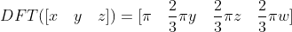
    - **橙子** (<small title="广东">2023-9-1 18:52:28</small>): 看sh的资料就可以了［害羞］
    - <a href="https://www.zhihu.com/people/huang-yi-min-74">布尔什维克</a> (<small title="回复于 2023-9-6 16:49:45/上海"> ✉️:橙子</small>): 就是看过sh资料之后，发现还是不太明白［大哭］
    - **橙子** (<small title="回复于 2023-9-6 18:26:10/广东"> ✉️:布尔什维克</small>): 🌝其实没必要知道怎么推导的，能用就行了。对于图形学来说，数学就是工具。那一堆算完其实就是个[线性变换](https://www.zhihu.com/search?comment_id=10671842364&comment_type=COMMENT&content_id=233249835&content_type=article&parent_comment_id=10667690275&q=%E7%BA%BF%E6%80%A7%E5%8F%98%E6%8D%A2&request_click_id=51fda3c7-a6ff-4c09-a999-24ede155cc5b&search_source=CommentEntity)，照着公式推就好啦。
    - <a href="https://www.zhihu.com/people/wumoyany">Lumos</a> (<small title="回复于 2023-9-11 23:5:14/广东"> ✉️:布尔什维克</small>): Ramamoorthi的On the relationship between radiance and irradiance: determining the illumination from images of a convex Lambertian object里有完整推导。
58. <a href="https://www.zhihu.com/people/qicad">鱼与熊掌</a> (<small title="福建">2023-9-1 11:23:0</small>): ［发呆］
59. <a href="https://www.zhihu.com/people/baiguang">肚皮</a> (<small title="北京">2023-9-1 15:50:13</small>): 不明觉厉！虽然现在看不懂，先mark给未来的自己看<div><br></div>[欢呼](https://pic1.zhimg.com/v2-ba306425d0a7aee2c7260381f1bf7b97.gif?source=1d2f5c51)
60. <a href="https://www.zhihu.com/people/rockwu-80">Maxmini</a> (<small title="四川">2023-8-31 16:10:23</small>): 场景大小的影响会比较大么
    - **橙子** (<small title="广东">2023-8-31 16:24:11</small>): 几乎没影响
    - <a href="https://www.zhihu.com/people/rockwu-80">Maxmini</a> (<small title="回复于 2023-9-1 10:33:58/四川"> ✉️:橙子</small>): 这个不会很影响体纹理大小么，还是有做[clipmap](https://www.zhihu.com/search?comment_id=10666602410&comment_type=COMMENT&content_id=233249835&content_type=article&parent_comment_id=10666727877&q=clipmap&request_click_id=8d1fdaa1-ddec-4cb2-abf1-498ec5a5cfd7&search_source=CommentEntity)之类的处理吗
    - **橙子** (<small title="回复于 2023-9-1 14:22:31/广东"> ✉️:Maxmini</small>): 有
61. <a href="https://www.zhihu.com/people/hr-j">UoO-OoU</a> (<small title="湖北">2023-8-31 15:51:57</small>): 我很仔细的看公式，但是越看越不懂［发呆］
62. <a href="https://www.zhihu.com/people/wumoyany">Lumos</a> (<small title="广东">2023-8-31 16:32:21</small>): ScreenSpaceGather没太懂，这里看起来存的是间接反弹的光而不是SH，是有depthPrepass提供了worldPos和worldNormal，就直接计算得到了diffuse了吗？
    - **橙子** (<small title="广东">2023-8-31 16:37:6</small>): 上一帧depth。然后把sh拿到屏幕空间然后把一些计算前置了减少basepass开销。
    - <a href="https://www.zhihu.com/people/wumoyany">Lumos</a> (<small title="回复于 2023-8-31 16:38:48/广东"> ✉️:橙子</small>): 视角变动较大的情况下有特殊处理吗？
    - **橙子** (<small title="回复于 2023-8-31 16:39:27/广东"> ✉️:Lumos</small>): 会reprojection
    - <a href="https://www.zhihu.com/people/wumoyany">Lumos</a> (<small title="回复于 2023-8-31 16:43:0/广东"> ✉️:橙子</small>): 然后不在depth上的就直接fallback采体纹理了吗？
    - **橙子** (<small title="回复于 2023-8-31 17:43:1/广东"> ✉️:Lumos</small>): basepass只采这个，不去弄体纹理，开销太高
    - <a href="https://www.zhihu.com/people/wumoyany">Lumos</a> (<small title="回复于 2023-9-2 16:30:13/广东"> ✉️:橙子</small>): 省是确实省，只是边缘效果会有点瑕疵。我试过即使有depthPrepass得到这帧准确的深度的前提下，降分辨率计算GI Diffuse，物体边缘处由于深度变化剧烈导致会与背景的光lerp，而产生类似于轮廓线的瑕疵，当然，一般情况可能不明显，但仔细看还是有的
    - **橙子** (<small title="回复于 2023-9-2 17:16:23/广东"> ✉️:Lumos</small>): 嗯嗯，不太明显，但是很省。
    - <a href="https://www.zhihu.com/people/enron-fancy">大智</a> (<small title="回复于 2023-9-6 11:3:35/浙江"> ✉️:Lumos</small>): 要求高的话，就不降分辨率了吧。手机上用，降降分辨率应该影响不大
    - **橙子** (<small title="回复于 2023-9-6 11:44:25/广东"> ✉️:大智</small>): 预算给到1ms可以不降
    - <a href="https://www.zhihu.com/people/he-de-jing">DeNjIeH</a> (<small title="回复于 2023-9-7 11:27:19/广东"> ✉️:橙子</small>): 用上一帧depth加reprojection对场景静态物体可以，但是对动态物体就不行了吧。比如玩家在墙面前移动，不会出现角色轮廓的拖影吗？。。不过硬要说的话，再给动态物体渲染一张velocity然后在reprojection的计算中修正一下好像也不是不可以解决
    - **橙子** (<small title="回复于 2023-9-7 12:23:22/广东"> ✉️:DeNjIeH</small>): 主要是省性能
    - **橙子** (<small title="回复于 2024-5-24 7:44:55/广东"> ✉️:Lumos</small>): 最新实践，用类似TAA里的Variance clipping思路可以解决拖影
63. <a href="https://www.zhihu.com/people/he-tian-yuan-35">禾田园</a> (<small title="湖北">2023-8-30 17:53:19</small>): 就是说以后所有游戏都可以有低开销的[全局光照](https://www.zhihu.com/search?comment_id=10665685629&comment_type=COMMENT&content_id=233249835&content_type=article&q=%E5%85%A8%E5%B1%80%E5%85%89%E7%85%A7&request_click_id=1b40b3b8-5f10-449e-ac84-48f8d9b1f136&search_source=CommentEntity)用了吗？太棒了！
    - **橙子** (<small title="广东">2023-8-30 17:56:34</small>): 理想情况是这样
64. <a href="https://www.zhihu.com/people/qian-li-bing-feng-52-21">无为而治</a> (<small title="广东">2023-8-30 16:7:30</small>): 看起来就是prt的改进版本呀
    - **橙子** (<small title="广东">2023-8-30 16:17:19</small>): 还没还没写完🌝准确说是local prt的lpv版
65. <a href="https://www.zhihu.com/people/will-24-24-94">will</a> (<small title="重庆">2023-8-30 23:39:29</small>): 厉害👍🏻
66. <a href="https://www.zhihu.com/people/dotb1ue">dotblue</a> (<small title="北京">2023-8-30 11:57:15</small>): 太强了，mark
67. <a href="https://www.zhihu.com/people/hong-kang-37">余弦</a> (<small title="北京">2023-8-30 14:12:31</small>): ［赞同］太强了、等更新
68. <a href="https://www.zhihu.com/people/hintjiang">酱酱紫仙贝</a> (<small title="北京">2023-8-30 10:16:21</small>): 太强了
69. <a href="https://www.zhihu.com/people/chen-si-min-xiao-fei-lang">老司机atKunlun</a> (<small title="中国香港">2023-8-30 16:44:44</small>): 这里考察的全部都是局部的信息，信息密度足够低所以全部的数据都能够被实时计算，而且场景随意变化。  <div><br></div>大佬，这里的探针是如何被场景更新的？CPU实时算的吗？
    - **橙子** (<small title="广东">2023-8-30 16:51:34</small>): 我后面单独拆一块来讲。那个偏工程，是在cpu 上做的，方便做稀疏化和压缩
    - <a href="https://www.zhihu.com/people/chen-si-min-xiao-fei-lang">老司机atKunlun</a> (<small title="回复于 2023-8-30 16:57:52/上海"> ✉️:橙子</small>): 理解了！！！相当于CPU去算Lumen里的[VoxelLighting](https://www.zhihu.com/search?comment_id=10665397851&comment_type=COMMENT&content_id=233249835&content_type=article&parent_comment_id=10665256541&q=VoxelLighting&request_click_id=77f9cef6-76c3-4864-8f2a-c52e9b53afe2&search_source=CommentEntity)！！！大佬牛逼！！！
    - **橙子** (<small title="回复于 2023-8-30 17:3:58/广东"> ✉️:老司机atKunlun</small>): 没算那么远，非常近，就是[邻接关系](https://www.zhihu.com/search?comment_id=10665194974&comment_type=COMMENT&content_id=233249835&content_type=article&parent_comment_id=10665256541&q=%E9%82%BB%E6%8E%A5%E5%85%B3%E7%B3%BB&request_click_id=77f9cef6-76c3-4864-8f2a-c52e9b53afe2&search_source=CommentEntity)。访存全部在cache上
    - **橙子** (<small title="回复于 2023-8-30 17:5:40/广东"> ✉️:老司机atKunlun</small>): 有点类似的意思就是
70. <a href="https://www.zhihu.com/people/skyteacher">Kent Zhang</a> (<small title="加拿大">2023-8-30 10:27:32</small>): 牛逼，0.5ms怎么弄的？我也只搞到1ms
71. <a href="https://www.zhihu.com/people/ni-jun-yang">koney</a> (<small title="浙江">2023-8-30 0:42:48</small>): 看到这里怎么感觉计算量比传统prt还大［捂脸］
    - **橙子** (<small title="广东">2023-8-30 7:15:22</small>): 这里的计算在cpu而且是逐物件的预计算
    - <a href="https://www.zhihu.com/people/skyteacher">Kent Zhang</a> (<small title="回复于 2023-8-30 10:31:52/加拿大"> ✉️:橙子</small>): 意思也还是有一些baking？预计算本地prt？然后并入全局？
    - **橙子** (<small title="回复于 2023-8-30 10:52:56/广东"> ✉️:Kent Zhang</small>): 实际上是预计算了逐物件的一个体素化。
    - **橙子** (<small title="回复于 2023-8-30 10:53:49/广东"> ✉️:Kent Zhang</small>): 嗯，是这个方向不过不是并入全局。并没有生成全局prt
    - <a href="https://www.zhihu.com/people/skyteacher">Kent Zhang</a> (<small title="回复于 2023-8-30 11:51:56/加拿大"> ✉️:橙子</small>): 最后lighting算irradiance是怎么个搞法？probe？tracing然后filter？还是？
    - **橙子** (<small title="回复于 2023-8-30 13:28:3/广东"> ✉️:Kent Zhang</small>): 没有tracing等我更新［害羞］
    - <a href="https://www.zhihu.com/people/wumoyany">Lumos</a> (<small title="回复于 2023-8-31 9:52:54/广东"> ✉️:橙子</small>): 相机移动、level steaming或物件移动时对“Dirty”探针在cpu端进行local visibility的预计算？64^3量级的climap计算消耗很大吧，如果再加上TOD的话，光照更新的延迟会不会很高？
    - <a href="https://www.zhihu.com/people/skyteacher">Kent Zhang</a> (<small title="回复于 2023-8-31 11:18:8/加拿大"> ✉️:橙子</small>): 最后光照怎么搞哦？算传递函数然后PRT那种？
    - <a href="https://www.zhihu.com/people/skyteacher">Kent Zhang</a> (<small title="回复于 2023-8-31 11:19:21/加拿大"> ✉️:橙子</small>): 我就玩过tracing和probe，prt还没玩过
    - **橙子** (<small title="回复于 2023-8-31 11:33:34/广东"> ✉️:Kent Zhang</small>): 不是不是，等我更新［害羞］
    - <a href="https://www.zhihu.com/people/skyteacher">Kent Zhang</a> (<small title="回复于 2023-8-31 12:0:21/加拿大"> ✉️:橙子</small>): ［doge］666666666赶紧的
    - **橙子** (<small title="回复于 2023-8-31 12:12:11/广东"> ✉️:Lumos</small>): 预计算开销不大，因为数据是稀疏的而且有cache，localvisibility就是顺序访存26次array。延迟会比较高，主要原因是我会在gpu上降帧分块更新。
72. <a href="https://www.zhihu.com/people/cai-bin-hong">ugcitcitc</a> (<small title="广东">2023-8-30 0:37:7</small>): 所以，这gi适合物件较少的手游使用？物件多了，性能消耗大大提升？
    - **橙子** (<small title="广东">2023-8-30 7:14:41</small>): 不会啊，开销与物件数量无关
73. <a href="https://www.zhihu.com/people/sabregodly">SabreGodLY</a> (<small title="广东">2023-8-30 9:52:16</small>): 先Mark
74. <a href="https://www.zhihu.com/people/ge-liang-sheng">三玖天下第一</a> (<small title="上海">2023-8-30 11:33:11</small>): 大佬，弱问一下，那个预计算可见性 sh\_b 在无穷反射推导里怎么体现，原谅我没看懂 ［大哭］［大哭］
    - **橙子** (<small title="广东">2023-8-30 13:28:32</small>): 就是每次要trpd一下
75. <a href="https://www.zhihu.com/people/blaze-27-83">blaze火神</a> (<small title="上海">2023-8-30 10:47:36</small>): 有点像把[LPV](https://www.zhihu.com/search?comment_id=10665062134&comment_type=COMMENT&content_id=233249835&content_type=article&q=LPV&request_click_id=2bacabee-4484-43d6-a7be-f84cfea92884&search_source=CommentEntity)的RSM提前烘到sh里平铺到空间中？如果这样的话，场景得是静态的吧，也可能是我理解错了。。
    - **橙子** (<small title="广东">2023-8-30 10:52:14</small>): 看是局部的，所以场景可以动
    - **橙子** (<small title="广东">2023-8-30 10:56:32</small>): 没有用到rsm。rsm还是和方向有关的。并且是全局性的。这里的数据都是局部的。
    - <a href="https://www.zhihu.com/people/blaze-27-83">blaze火神</a> (<small title="回复于 2023-8-30 18:9:38/上海"> ✉️:橙子</small>): 哦哦，谢谢大佬！再确认一下，是不是就是只需要烘[albedo](https://www.zhihu.com/search?comment_id=10665401238&comment_type=COMMENT&content_id=233249835&content_type=article&parent_comment_id=10665062134&q=albedo&request_click_id=2ebcefc4-0330-4a0c-a2c7-d7f07779b9c4&search_source=CommentEntity)和可见性，而因为是局部的，可以逐物体烘焙？
    - **橙子** (<small title="回复于 2023-8-30 19:3:29/广东"> ✉️:blaze火神</small>): 是的是的［害羞］
76. <a href="https://www.zhihu.com/people/dosusang">dosusang</a> (<small title="广东">2023-8-30 9:25:7</small>): 码了就是学了
77. <a href="https://www.zhihu.com/people/ni-jun-yang">koney</a> (<small title="浙江">2023-8-30 0:52:37</small>): 动态场景下精确的局部可见性很难快速计算的，特别在移动端，［捂脸］不知道有什么黑科技
78. <a href="https://www.zhihu.com/people/lin-xi-34-43-19">糯米</a> (<small title="广东">2023-8-29 20:40:34</small>): mark
79. <a href="https://www.zhihu.com/people/liao-zhu-97-67">西北爱xx</a> (<small title="浙江">2023-8-29 21:26:13</small>): 请问下可见性是算的到某个固定距离（理解为天空）的可见性吗
    - **橙子** (<small title="广东">2023-8-29 22:7:11</small>): 这个是局部的。非常近的，半米左右
80. <a href="https://www.zhihu.com/people/zhiqingli">李知青</a> (<small title="江苏">2023-8-29 20:56:27</small>): 好强
81. <a href="https://www.zhihu.com/people/mikude-hua-ni-zeiyi-ge">miku的话呢zei一个</a> (<small title="湖北">2023-8-29 20:50:34</small>): 项目叫啥啊
    - **橙子** (<small title="广东">2023-8-29 21:18:15</small>): 保密［害羞］
82. <a href="https://www.zhihu.com/people/chen-zhi-han-14-97">LucasChen</a> (<small title="广东">2023-8-29 20:9:47</small>): 太强了<div><br></div>[欢呼](https://picx.zhimg.com/v2-ba306425d0a7aee2c7260381f1bf7b97.gif?source=1d2f5c51)
    - <a href="https://www.zhihu.com/people/ding-cheng-feng-2">dandes</a> (<small title="上海">2024-12-18 12:59:58</small>): p
    - <a href="https://www.zhihu.com/people/ding-cheng-feng-2">dandes</a> (<small title="上海">2024-12-18 13:0:15</small>): p p
83. <a href="https://www.zhihu.com/people/yi-ge-diao-yu-shao">一个鲷鱼烧</a> (<small title="北京">2023-8-30 10:39:39</small>): wow
84. <a href="https://www.zhihu.com/people/zhou-hao-13-12">小天才</a> (<small title="北京">2023-8-30 11:54:38</small>): 太强啦［蹲］
85. <a href="https://www.zhihu.com/people/su-jun-95-8">阿珺</a> (<small title="上海">2023-8-30 11:23:23</small>): Mark［惊喜］
86. <a href="https://www.zhihu.com/people/aery-86">Aery</a> (<small title="广东">2023-8-30 8:58:52</small>): 我没理解错的话，类似于均匀分布在场景的prt probes？
    - **橙子** (<small title="广东">2023-8-30 9:19:55</small>): 不是不是还没完呢
    - <a href="https://www.zhihu.com/people/aery-86">Aery</a> (<small title="回复于 2023-8-30 9:22:5/广东"> ✉️:橙子</small>): 期待期待［赞同］
87. <a href="https://www.zhihu.com/people/wu-yue-di-27">五月底</a> (<small title="上海">2023-8-29 21:33:2</small>): 太强了
88. <a href="https://www.zhihu.com/people/yuan-teng-peng">silver bullet</a> (<small title="上海">2023-8-29 20:30:13</small>): 牛逼
89. <a href="https://www.zhihu.com/people/qian-pan-po-17">AsahiChan</a> (<small title="浙江">2023-8-30 2:8:43</small>): tql
90. <a href="https://www.zhihu.com/people/wang-jie-2-86">wakare</a> (<small title="上海">2023-8-29 23:39:18</small>): 太强了 期待后续 ［蹲］
91. <a href="https://www.zhihu.com/people/papalqi">papalqi</a> (<small title="广东">2023-8-29 19:23:2</small>): 大佬！
    - **橙子** (<small title="广东">2023-8-29 19:28:15</small>): 小傻瓜
92. <a href="https://www.zhihu.com/people/CursorChan">鼠标酱</a> (<small title="广东">2023-8-29 18:43:30</small>): 好牛！
93. <a href="https://www.zhihu.com/people/zhang-yan-99-47">山石</a> (<small title="北京">2023-8-29 18:58:29</small>): 你怎么黄了
    - **橙子** (<small title="广东">2023-8-29 19:5:16</small>): 深圳太热晒黑了🤕
94. <a href="https://www.zhihu.com/people/wumoyany">Lumos</a> (<small title="广东">2023-8-29 18:44:34</small>): 赞！等了好久［大笑］
95. <a href="https://www.zhihu.com/people/li-xiang-he-46">leesanghoy</a> (<small title="四川">2023-8-29 20:44:32</small>): [天顶星科技](https://www.zhihu.com/search?comment_id=10664236077&comment_type=COMMENT&content_id=233249835&content_type=article&q=%E5%A4%A9%E9%A1%B6%E6%98%9F%E7%A7%91%E6%8A%80&request_click_id=5bde1cdb-bcb1-417a-9260-11c8d10cc2a4&search_source=CommentEntity)来了吗 太强了
96. <a href="https://www.zhihu.com/people/Homuri_hkr">Ikigai</a> (<small title="上海">2023-8-29 18:49:5</small>): 吊了很久胃口终于有文章了，先马一下


=[评论](./attachments/comments.json)

